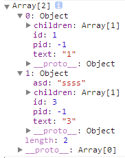
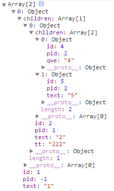

## 简介:

       树形菜单在b/s编程中经常碰到,但是并不是每个tree插件都支持List类型的json数据,同时由于后台转换并不如前端节省资源,所以作此插件;

## 主要功能:

     1.可以自定义属性名称;

     2.可以多字段排序;

     注意:此插件无去重复功能,所以数据可能重复的,请自行去重复之后再行使用;

## 示例:

```html
<html>
<script type="text/javascript" src="wg_listToTree1.1.js"></script>
<script type="text/javascript">
var tree=[{id:2,pid:1,text:'2',tt:'222'},{id:3,pid:-1,text:'3',asd:'ssss'},
{id:5,pid:2,text:'5'},{id:4,pid:2,kk:'4'},{id:1,pid:-1,text:'1'},
		  {id:6,pid:3,text:'6'},{id:7,pid:0,text:'7'},{id:9,pid:-2,text:'9'}];
window.onload=function(){
var param={
	list:tree,
inParams:{
			pid:"pid",
			rootId:-1,
			id:'id',
			},
	outParams:{
			children:"children",
			pid:"pid",
			id:'id',
			kk:'qwe',
			state:'state',	
		},
		sort:{
			orderBy:["pid","id"],
			sort:"asc",	
		}
};
var a=wg_listToTree(param);
console.info(a);
};
</script>
</html>
```

结果:

             

    说明:对于无用的干扰数据,插件将会忽略;

## 使用方法:

                1.导入相关js文件;

                 2.调用函数,传入参数;

                     函数名称:wg_listToTree( param);其中param是一个json对象,里面包含有参数的具体内容;

                    分别是list,inParams,outParams,sort四个json对象,分别代表数据,输入参数,输出参数和排序参数;

                    函数执行后会返回一个tree格式的json对象;

## 参数介绍:

                    list: 一个json数组,javascript数组;格式:[{id:2,pid:1,text:'2',tt:'222'},{....}]

                     inParams:一个json对象,包含三个属性;

                        { pid:"pid",//父节点的编号的名称  
rootId:-1,//根节点的值  
id:'id',//当前节点的编号的名称

                          }  

                     outParams: 一个json对象,可包含多个属性;           

                         {  
children:"children",//子节点数组的名称  
pid:"pid",//父节点的编号的名称  
id:'id',//当前节点编号的名称  
kk:'qwe',//list数组对象中,自身有个属性叫kk,想输出名称为'qwe';  
state:'state', //同kk  
        } //注意:其他list中原有属性,会相应的保留....理论上

                    sort:一个json对象,用户排序,不指定,或者传入null表示不排序,排序会消耗一定资源

                       {  
orderBy:["pid","id"],//排序中指定的排序字段,和outParams中输出的字段名称一一对应;这里表示用pid排序,如果相等,再用id字段排序  
sort:"asc",//排序的方式,asc表示升序,其它表示降序   
       }

## 插件下载:

                     [点击打开链接](http://download.csdn.net/detail/huitoukest/9045007)
