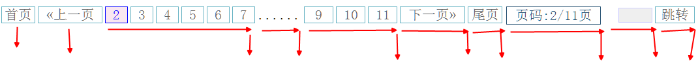

##

## 前言:

    现在这个分页插件也不少,感觉缺点什么,所以自己就写了一个,喜欢的人就拿去用......有bug和建议可以回复,我有空就修改和答复.....

    感谢我的基友,刘总...他主要给本插件写配套主题css;


## 特点:

    整合ajax可以异步和后台交互数据,定制化选项多.和Jquery的pagenation比较类似,但是功能更多,选择性更多.

    当前版本:1.1

    完成日期:20151008

## 改进:

     1.修复了1.0中beforeRender函数在success函数之前执行的bug;  
     2.改success函数返回值为总记录数,改返回值将会被插件接收并使用;  
     3.改beforeRender将会传入参数,参数为wgPagenation的系统分页参数;  
     4.通过id选择器,提高默认的三个css的优先级别,同时微调部分css;  
     5.用户传入的向后台发送的参数,由对象方式改为函数返回值获取的方式,以方便动态传参;  
     6.对外发布源码和压缩两个版本;  
     7.增加方法调用的说明;

## 效果图:

White.css的效果图:      


default.css效果图:

   

     上图上向下的箭头表示的是每一个可选择和更改的区域,用户可以对这些区域进行css或是否显示等等的更改.

  

更多css请自己尝试......

## 需要引入的文件:

                     由于本插件基于Jquery1.9.1制作,所以首先必须导入Jquery的js文件,当然不一定是1.9.1版本,兼容性自己测试......

                     具体需要导入的文件有如下几个,请最好按照顺序导入:

                       1.Jquery的js文件

                       2.css文件:目前有wg_pagenation_default.css和wg_pagenation_white.css  
                          和wg_pagenation_transparent.css三种,可以自行选择导入一种

                       3.wg_pagenation.js文件

## 最简单示例:             

```html
<html>
<head>
<title>wgPagenation----无刷新翻页</title>
	<meta http-equiv="Content-Type" content="text/html;charset=utf-8">	
	<script src="jquery-1.9.1.min.js"></script>
	<link rel="stylesheet" href="wg_pagenation_default.css" type="text/css" />
	<script src="wg_pagenation.js"></script>
	<script type="text/javascript">
	 $(function(){
	wgPagenation();
	});
	</script>
</style>
</head>
<body>
<div id="Pagination" align="center"></div>
</body>
</html>
```

显示效果:

        

## 更多功能选择:

                  本分页插件拥有许多可以选择的功能,具体可调用wgPagenation();函数  
                  然后传入一个功能参数的json对象即可;

             示例:

```html
wgPagenation({ url:'#',
row:7,
page:1,
params:{articleId:3}
});
```

                更多参数以及默认参数如下,其中所有参数均是可选:

//分页数据  
//以下是字符串变量参数  
content:"Pagination",//指定一个div的id,来初始化分页内容

orderBy:null,//升序还是降序排列

sort:null,//排序的字段

row_name:'row',//row参数传回与接收的时候显示的参数名称

page_name:'page',//page参数传回与接收的时候显示的参数名称

count_name:'count',//count参数传回与接收的时候显示的参数名称

orderBy_name:'orderBy',//orderBy参数传回与接收的时候显示的参数名称

sort_name:'sort',//sort参数传回与接收的时候显示的参数名称

url:'#',//分页数据url,默认跳转到当前页面

prev_text: '上一页',       //上一页按钮里text

next_text: '下一页',       //下一页按钮里text

goTo_text:'跳转',//跳转按钮显示文字

first_page_text:'首页',//首页按钮显示的文字

end_page_text:'尾页',////尾页按钮显示的文字

ellipse_text:'......',//左右两边连续页数中间,省略的页数用什么文字表示

dataType:'text',//同ajax中dataType

createTime:'2015-10-08',

author:'wg huitoukest',//标识作用

version:'1.1',  

//以下是数字变量参数  
row:10,//每页多少行数据

page:1,//当前页面

count:0,//后台返回的总记录数量

totalPage:1,//总的页数,用户无需指定,通过前台可以自己核算出来

num_display_left:5,//左边显示的连续页数显示按钮

num_display_right:3,//右边显示的连续页数显示按钮

timeout:50000, //加载时间,同ajax中timeout;  

//以下是布尔变量参数  
prev_show_always:true,//是否显示“前一页”分页按钮布尔型，可选参数，

next_show_always:true,//默认为true，即显示“下一页”按钮

first_show_always:true,//是否显示首页

end_show_always:true,//是否显示尾页

showTotalPageInfo:true,//是否显示总页数信息

async:true,//同ajax中async

cache:false,//同ajax中cache  

//以下是函数function变量参数  
onclick:function(data){return true;},//点击按钮之后的回调的函数,而传回的这个data就是button的页码数值, 或者用户输入的input的值,返回false可以阻止向服务器发送数据

success:function(data){ return wg_pageParam.count},//成功接收服务器数据之后的回调函数,data是服务器发送的数据, 同ajax,同时返回总的记录数量

error:function(XMLHttpRequest, textStatus, errorThrown){},//连接服务器失败的回调函数,同ajax

beforeSend:function(XMLHttpRequest){},//同ajax中的beforeSend

beforeRender:function(param){return true;},//渲染分页之前调用的回调函数,返回false或者无返回值将阻止渲染, 传入的参数就是系统分页对象wg_pageParam

totalPageInfoFunction:function(page,totalPage){  
             return '页码:'+page+"/"+totalPage+"页";  
},//渲染页数信息的函数,要求返回一个可包含html代码的字符串,传入当前页号,和总页数

params:function(){return{};},//返回分页数据需要传递的参数,除开分页信息外的参数

注意: 在插件初始化之后,会往后台发送用户指定url请求,以获取分页和页面数据信息.

      在获取后台的数据成功后,此时,用户可以通过配置参数中的success方法,来得到分页的数据和信息.      

      同时其他参数也可以通过wg_pageParam.XXX=YYY的方式来动态更改;同样通过wg_pageParam.XXX可以获得当前使用的参数

## 插件执行逻辑(顺序):

                             onclick-->和服务器交互数据-->beforeRender-->渲染分页div内容;

                             所以,在插件初始化渲染之前,实际上会从用户指定的onclick函数执行起;

## 更多样式选择:  

                  示例:

```html
wgPagenation({ url:'#',row:7,page:1,params:{articleId:3},{                                                                                                                     
//此对象内就是用户自定的css
	                 num_display_css:'my_num_display_css',
			 num_currentPage_css:'my_num_currentPage_css'}
});
```

                 然后自定义相关的css:

```html
<style type="text/css">
.my_num_display_css
{
border:1px;
border-color:#999999;
text-decoration: none;
border-style: solid;
color:#AAAAAA;
}

.my_num_currentPage_css{
XXX
}
</style>
```

                更多自定义css选项:

                                可以用wgPagenation({ },{ 这里放你自定义css的信息 });  
                               来传入css的参数,实际上也就是wgPagenation的第二个参数:

                示例以及css参数说明,以及css样式默认名称:       

```text
wgPagenation({ url:'#',row:7,page:1,params:{articleId:3},{
//此对象内css的值对应相应div中,class="XXX",class=""用来指定显示的样式;
	         num_display_css:'wg_num_display_css',//中间连续分页的按钮的css
			 num_currentPage_css:'wg_num_currentPage_css',//中间当前页码的显示css
			 totalPageInfo_css:'wg_totalPageInfo_css',//显示总页数的div的css
			 ellipse_text_css:'wg_ellipse_text_css',//省略页数的符号的css
			 first_show_css:'wg_first_show_css',//首页按钮css
			 end_show_css:'wg_end_show_css',//尾页按钮的css
			 first_show_disable_css:'wg_first_disable_css',//首页按钮css,首页被禁用的css
			 end_show_disable_css:'wg_end_disable_css',//尾页按钮的css,尾页被禁用的css
			 prev_css:'wg_prev_css',//上一页按钮的css
			 next_css:'wg_next_css',//下一页按钮的css
			 prev_disable_css:'wg_prev_disable_css',//上一页按钮的css,上一页被禁用的css
			 next_disable_css:'wg_next_disable_css',//下一页按钮的css,下一页被禁用的css
			 gotoPage_css:'wg_gotoPage_css',//跳转按钮的css样式
gotoPageInput_css:'wg_gotoPageInput_css',//输入页码的input的样式			 
	  });<span style="font-family: Arial, Helvetica, sans-serif;">          </span>
```

            注意:可以通过wg_pageCss.XXX来获取实时css,通过wg_pageCss.XXX=XXX来动态设定css;

## 方法调用:

           本插件的所有方法都存储与wg_pageFunction对象中,可以通过wg_pageFunction.XXX()的方式来调用;

          gotoPage:function(page) 传入参数page,一个页面编号,如wg_pageFunction.gotoPage(5);表示跳转到第五页;

reLoadCurrentPage  刷新当前页面;wg_pageFunction.reLoadCurrentPage();

gotoNextPage   跳转到下一页

gotoPrePage   跳转到上一页

gotoLastPage  跳转到末页

gotoFirstPage 跳转到首页

gotoCustomPage 跳转到用户输入的页面

setPager 渲染分页div

getPager 从服务器获取数据,并渲染div

## 下载:              

      以下是插件用到的css和js文件下载,完全免费,源码公开:

        [点我下载wgPagenation_1.1](http://download.csdn.net/detail/huitoukest/9163841)

如果你有学好的css,并使用良好,可以联系我,以分享给更多人使用;

如果你在使用中觉得有bug或者有需要改进的地方,可以留言;
