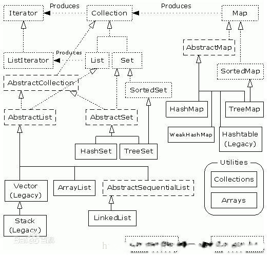

# 简介
java的set用于存放值不重复的对象，其结构如图。

Set接口继承自Collection接口，而SortedSet接口继承自Set。AbstractSet是一个抽象类。
Set主要有两种实现HashSet和TreeSet、LinkedHashSet。

# AbstractSet
```java
public abstract class AbstractSet<E> extends AbstractCollection<E> implements java.util.Set<E> {
    protected AbstractSet() {
    }
 /**
 * 只要实现了Set接口，那么就会比较集合中包含的元素值，如果个数相同且都包含，则相等。
 */
    public boolean equals(Object o) {
        if (o == this)
            return true;
        if (!(o instanceof Set))
            return false;
        java.util.Collection c = (Collection) o;
        if (c.size() != size())
            return false;
        try {
            return containsAll(c);
        } catch (ClassCastException unused) {
            return false;
        } catch (NullPointerException unused) {
            return false;
        }
    }

     /**
     * 得到set的hashcode。假如当前值为null的时候，它的hashcode是0，
     * 最后返回的是set中所有元素的hashcode的和。
     */
    public int hashCode() {
        int h = 0;
        Iterator<E> i = iterator();
        while (i.hasNext()) {
            E obj = i.next();
            if (obj != null)
                h += obj.hashCode();
        }
        return h;
    }
     /**
     * 删除给定容器包含的所有元素，成功返回true，失败返回false
     */
    public boolean removeAll(Collection<?> c) {
        boolean modified = false;
        if (size() > c.size()) {
            for (Iterator<?> i = c.iterator(); i.hasNext(); )
                modified |= remove(i.next());
        } else {
            for (Iterator<?> i = iterator(); i.hasNext(); ) {
                if (c.contains(i.next())) {
                    i.remove();
                    modified = true;
                }
            }
        }
        return modified;
    }
}  
```

# HashSet
HashSet的数据存储时基于HashMap来存储，从java1.2开始实现基本没变。
HashSet将用户存入的值作为键保存到HashMap中，使用一个属性PRESENT来作为固定值保存到HashMap的值中，
PRESENT是一个静态常量Object对象，因为Map的键唯一特性，所以Set的值也是不重复的。
其中的size，iterator，isEmpty，contains等方法全部直接调用Map中的相应方法。

AbstractSet主要实现了Cloneable和Serializable的功能。
```java
public class HashSet<E>
    extends AbstractSet<E>
    implements Set<E>, Cloneable, java.io.Serializable
{
    static final long serialVersionUID = -5024744406713321676L;
    private transient HashMap<E,Object> map;
    // PRESENT:在备份映射中与对象关联的虚拟值。
    private static final Object PRESENT = new Object();
    public HashSet() {
        map = new HashMap<>();
    }
    public HashSet(Collection<? extends E> c) {
        map = new HashMap<>(Math.max((int) (c.size()/.75f) + 1, 16));
        addAll(c);
    }
    public HashSet(int initialCapacity, float loadFactor) {
        map = new HashMap<>(initialCapacity, loadFactor);
    }
    public HashSet(int initialCapacity) {
        map = new HashMap<>(initialCapacity);
    }
    HashSet(int initialCapacity, float loadFactor, boolean dummy) {
        map = new LinkedHashMap<>(initialCapacity, loadFactor);
    }
  //size，iterator，isEmpty，contains，clear。。。
  //元素不存在是返回true，否则返回false
    public boolean add(E e) {
        return map.put(e, PRESENT)==null;
    }
    public boolean remove(Object o) {
        return map.remove(o)==PRESENT;
    }
    //克隆时分别克隆当前对象和Map，这样是深度克隆两个对象
    @SuppressWarnings("unchecked")
    public Object clone() {
        try {
            HashSet<E> newSet = (HashSet<E>) super.clone();
            newSet.map = (HashMap<E, Object>) map.clone();
            return newSet;
        } catch (CloneNotSupportedException e) {
            throw new InternalError(e);
        }
    }
   //序列化，defaultWriteObject执行默认的序列化，但是忽略transient HashMap<E,Object> map
  //然后写入的Map的一些信息，最后依次序列化的Map中的元素，所以实际上是忽略了map中的Key值。
    private void writeObject(java.io.ObjectOutputStream s)
        throws java.io.IOException {
        // Write out any hidden serialization magic
        s.defaultWriteObject();
        // Write out HashMap capacity and load factor
        s.writeInt(map.capacity());
        s.writeFloat(map.loadFactor());
        // Write out size
        s.writeInt(map.size());
        // Write out all elements in the proper order.
        for (E e : map.keySet())
            s.writeObject(e);
    }

    private void readObject(java.io.ObjectInputStream s)
        throws java.io.IOException, ClassNotFoundException {
        // Read in any hidden serialization magic
        s.defaultReadObject();
        // Read capacity and verify non-negative.
        int capacity = s.readInt();
        if (capacity < 0) {
            throw new InvalidObjectException("Illegal capacity: " +
                                             capacity);
        }
        // Read load factor and verify positive and non NaN.
        float loadFactor = s.readFloat();
        if (loadFactor <= 0 || Float.isNaN(loadFactor)) {
            throw new InvalidObjectException("Illegal load factor: " +
                                             loadFactor);
        }
        // Read size and verify non-negative.
        int size = s.readInt();
        if (size < 0) {
            throw new InvalidObjectException("Illegal size: " +
                                             size);
        }
        // Set the capacity according to the size and load factor ensuring that
        // the HashMap is at least 25% full but clamping to maximum capacity.
        capacity = (int) Math.min(size * Math.min(1 / loadFactor, 4.0f),
                HashMap.MAXIMUM_CAPACITY);
        // Create backing HashMap
        map = (((HashSet<?>)this) instanceof LinkedHashSet ?
               new LinkedHashMap<E,Object>(capacity, loadFactor) :
               new HashMap<E,Object>(capacity, loadFactor));
        // Read in all elements in the proper order.
        for (int i=0; i<size; i++) {
            @SuppressWarnings("unchecked")
                E e = (E) s.readObject();
            map.put(e, PRESENT);
        }
    }
  //1.8中新增的，返回一个并行的迭代器Spliterator
    public Spliterator<E> spliterator() {
        return new HashMap.KeySpliterator<E,Object>(map, 0, -1, 0, 0);
    }
}
```
**因为底层是HashMap，所以支持值是null**

# LinkedHashSet
LinkedHashSet继承自HashSet，LinkedHashSet内部使用的是LinkHashMap保存数据，这样可以保证LinkedHashSet中的元素是有序的，即遍历序和插入序是一致的。

# TreeSet
TreeSet的实现依赖于TreeMap，其余和HashSet的结构类似，由于TreeMap的结构，可以实现插入排序功能，默认升序。
```java
public class TreeSet<E> extends AbstractSet<E>
    implements NavigableSet<E>, Cloneable, java.io.Serializable
```
容器中的元素可以通过实现Comparable结构实现插入排序，或者实现Comparator类手动排序。

# 线程安全的Set
- 通用构建
通过Collections.synchronizedSortedSet返回一个线程安全的Set
```java
SortedSet s = Collections.synchronizedSortedSet(new TreeSet(...))
```

- 通过ConcurrentHashMap
```java
Set<String> words = ConcurrentHashMap.<String> newKeySet();  
```
