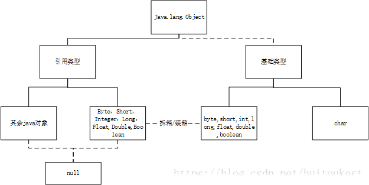
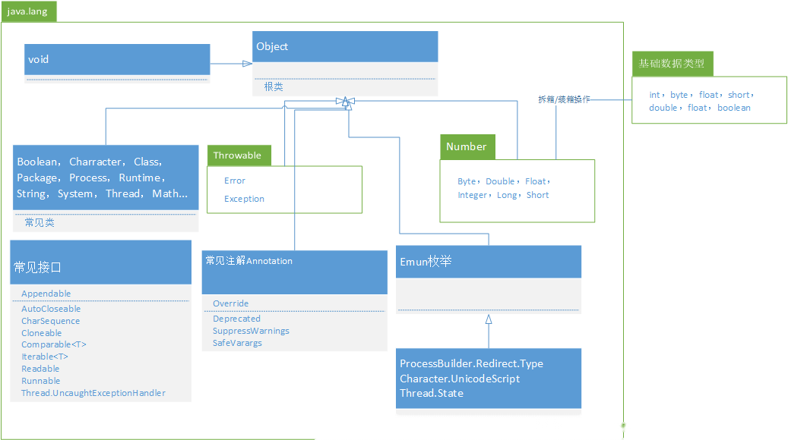
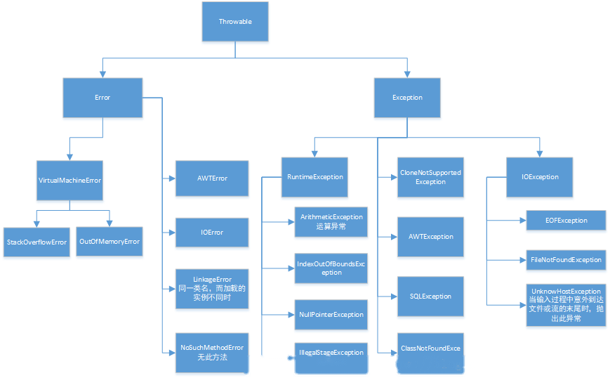
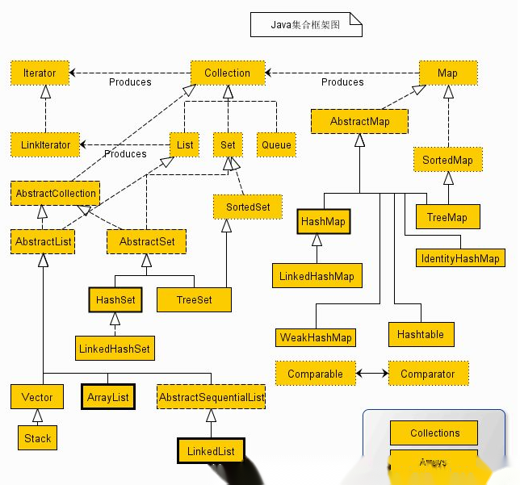
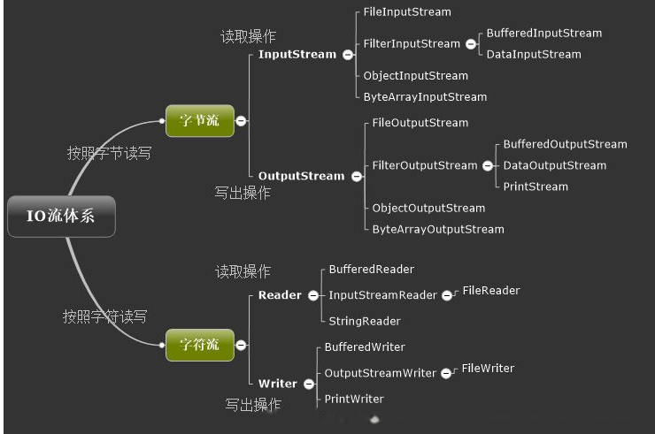
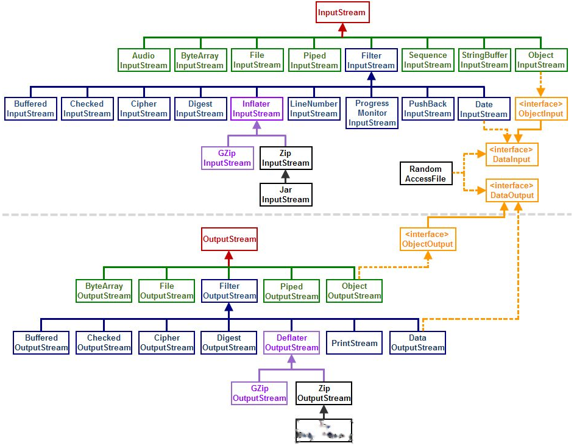
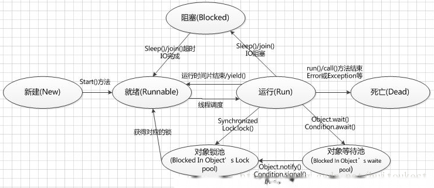
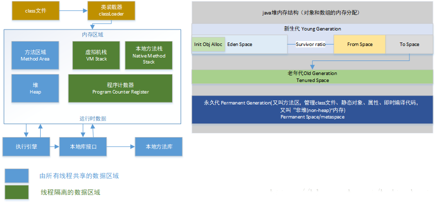

# 简介
本文主要简介java语言中常用类/接口/jvm的结构。
注意：不同java版本的结构可能有不同

# 常用java包

java中常用的几个包介绍：
包名| 说明
---- | ----
java.lang| 该包提供了Java编程的基础类，例如 Object、Math、String、StringBuffer、System、Thread等，不使用该包就很难编写Java代码了。
java.util | 该包提供了包含集合框架、遗留的集合类、事件模型、日期和时间实施、国际化和各种实用工具类（字符串标记生成器、随机数生成器和位数组）。
java.io | 该包通过文件系统、数据流和序列化提供系统的输入与输出。
java.net | 该包提供实现网络应用与开发的类。
java.sql | 该包提供了使用Java语言访问并处理存储在数据源（通常是一个关系型数据库）中的数据API。
java.awtjavax.swing  | 这两个包提供了GUI设计与开发的类。java.awt包提供了创建界面和绘制图形图像的所有类，而javax.swing包提供了一组“轻量级”的组件，尽量让这些组件在所有平台上的工作方式相同。
java.text | 提供了与自然语言无关的方式来处理文本、日期、数字和消息的类和接口。

# java类结构层次图

说明：
- 内存占用与极值
byte占用一个字节
short占用两个字节
int类型占用四个字节
long类型占用八个字节
float类型占用4个字节
double类型占用8个字节
char字符类型占用两个字节，在内存中对应整形int。
boolean类型占用一个字节，在内存中0=false，1=true。

- 内存存放位置
基础数据类型存放在栈区（又叫堆栈区），引用的句柄数据（类名或者数组）
存放在栈区。
引用数据类型的实例化数据存放在堆区域。
运行时常量池(如字面量)存放在方法区中。

# java.lang包简单结构

注意：
java包下的实现类大部分实现了接口：java.io.Serializable , java.lang.Cloneable

# java异常结构

# java常用容器结构

# java io流结构

## InputStream结构

# java线程状态

# jvm内存结构

