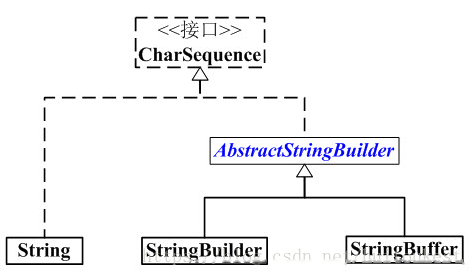

# 简介
String,StringBuilder,StringBuffer都是CharSequence(接口)的实现。
，而,StringBuffer继承了AbstractStringBuilder,
而AbstractStringBuilder直接实现了CharSequence接口。



- CharSequence
CharSequence是一个接口，定义了length(), charAt(int index), subSequence(int start, int end)几个方法。

- String
String 是CharSequence的直接实现。
String类被final所修饰，也就是说String对象是不可变类，是线程安全的。
String的内容存放在char[]中，此数组被final修饰，所以引用不可改变。
在每次对 String 进行内容操作的时候其实都生成了一个新的 String 对象，
然后将指针指向新的 String 对象，所以经常改变内容的字符串最好不要用 String。
**String适用于字符串内容不变的操作，或者字符串操作很少时**

注意：编译时，会将多个String字面量的+操作转换为一个字面量形式。
如 String a = "a" + "b" + "c"; 实际上是String a = "abc".

- StringBuilder
StringBuilder的内容也存放在char[]中，此char的引用对象可以改变。
此数组默认大小是16个字符，当调用append方法增加字符串内容时，
默认会将增加的字符串内容拷贝到字符数组中。
如果容量不够，那么会进行扩容操作：
 - 计算新char数组容量=原数组长度*2 + 2，依次循环直到char数组长度大于内容+原数组的长度。
 - 新建数组，拷贝内容
所以当字符串的内容变化时，如果不扩容，则不会有产生新的数组和内容拷贝，所以效率高。
而如果需要扩容，则要产生新char数组对象，同时还要进行内容拷贝，所以效率很低。

java.lang.StringBuilder是jdk1.5新增的。
此类提供一个与 StringBuffer 兼容的 API，但不保证同步。

**StringBuilder适用于单线程下对字符缓冲区进行大量操作的情况**

- StringBuffer
可以简单理解为是StringBuilder的线程安全的实现（简单理解为对内容操作/读取的方法上都加上了锁，
以保证线程安全）。
**StringBuffer适用多线程下在字符缓冲区进行大量操作的情况**

# 常用操作

## 复用StringBuilder/StringBuffer对象
在最总得到的字符串长度相对固定的情况下，复用sb对象能够提高效率。
通过调用sb对象的setLength方法来"初始化内容"，但是又不用重新建对象，所以理论上能提高一些效率
```java
@Test
public void test006(){
   int testCount = 10000000;
   long startTime = System.currentTimeMillis();
    for(int i = 0;i < testCount ; i++){
        getId0(1,"212312332");
    }
    System.out.println("use Time:" + (System.currentTimeMillis() - startTime) / 100 / 10.0);
   for(int i = 0;i < testCount ; i++){
       getId(1,"212312332");
   }
   System.out.println("use Time:" + (System.currentTimeMillis() - startTime) / 100 / 10.0);
    startTime = System.currentTimeMillis();
    for(int i = 0;i < testCount ; i++){
        getId2(1,"212312332");
    }
    System.out.println("use Time:" + (System.currentTimeMillis() - startTime) / 100 / 10.0);
}
public String getId0(int key,String key2){
    return System.currentTimeMillis() + key2 + key;
}
public String getId(int key,String key2){
    StringBuilder sb = new StringBuilder();
    sb.append(System.currentTimeMillis());
    sb.append(key2);
    sb.append(key);
    return sb.toString();
}
private static StringBuilder sb = new StringBuilder();//需要保证sb对象仅仅在此类中被使用
public static synchronized String getId2(int key,String key2){
    sb.setLength(0);//通过setLength，将内容“清空”
    sb.append(System.currentTimeMillis());
    sb.append(key2);
    sb.append(key);
    return sb.toString();
}
```
在jdk1.8下，用笔者家用机输出的结果如下：
```java
use Time:1.4
use Time:2.5
use Time:0.8
```
**注意：**

这里可以看到使用String的+操作的效率反而比sb的append效率高。
可以推出当字符串变化次数较少时，使用String对象的效率可能比sb对象更高。
实际上有的编译器会自动将a+b+c的形式自动优化为sb.append(a).append(b).append(c).toString()的代码。

# 设计和实现解析
## String
```java
//用于存储字符串 内从，final修饰引用不能变。
//由于是数组实现，数组的长度固定，所以内容不可能增加
//而String中也不允许内容变少，所以String的内容是不可变的，这导致String的不可变性质。
private final char value[];
//缓存String的hash值
private int hash;
// Default to 0/** use serialVersionUID from JDK 1.0.2 for interoperability */
private static final long serialVersionUID = -6849794470754667710L;
public String() {
    this.value = new char[0];
}
//参数为String类型
public String(String original) {
    this.value = original.value;
    this.hash = original.hash;
}
//参数为char数组，使用java.utils包中的Arrays类复制
public String(char value[]) {
    this.value = Arrays.copyOf(value, value.length);
}
//从bytes数组中的offset位置开始，将长度为length的字节，以charsetName格式编码，拷贝到value
public String(byte bytes[], int offset, int length, String charsetName)
        throws UnsupportedEncodingException {
    if (charsetName == null)
        throw new NullPointerException("charsetName");
    checkBounds(bytes, offset, length);
    this.value = StringCoding.decode(charsetName, bytes, offset, length);
}
//调用public String(byte bytes[], int offset, int length, String charsetName)构造函数
public String(byte bytes[], String charsetName)
        throws UnsupportedEncodingException {
    this(bytes, 0, bytes.length, charsetName);
}
```

- equals方法
 - 内存地址相同，则为真。
 - 如果对象类型不是String类型，则为假
 - 如果对象长度不相等，则为假。
 - char数组从后往前，判断其中每次字符是否相等，有不相等则为假。
 - 如果类型是String，长度相等，且每个字符都相等（char是基础类型，是做等值运算），则返回真。

- compareTo方法
以a.compareTo(b)为例，minLength 是a和b中的长度值中的最小者。
 - 从0到minLength - 1 依次比较a和b的char数组中的值,
假设x是遍历的索引值，若不相等，返回a[x] - b[x]的值,否则返回0。
 - 若从0到minLength - 1的值都相等，返回a.length - b.length的值。

- hashCode方法
String重写了Object中的hashCode方法。
 - 如果没有计算过hash值(hash默认值即int默认值，是0)，且字符串长度大于0，进行hashCode计算

- trim方法
找出首尾非空字符的索引，通过此索引截取字符串返回新对象。
```java
public String trim() {
    int len = value.length;
    int st = 0;
    char[] val = value; /* avoid getfield opcode */
    while ((st < len) && (val[st] <= ' ')) {
        st++;
    }
    while ((st < len) && (val[len - 1] <= ' ')) {
        len--;
    }
    return ((st > 0) || (len < value.length)) ? substring(st, len) : this;
}
```

- intern方法
intern方法是Native调用，它的作用是在方法区中的常量池里通过equals方法寻找等值的对象，
如果没有找到则在常量池中开辟一片空间存放字符串并返回该对应String的引用，
否则直接返回常量池中已存在String对象的引用。
```java
@Test
public void test000(){
    long time = System.currentTimeMillis();
    String s1 = time + "123" + 123132;
    String s2 = time + "123"+ 123132;
    String s3 = "132123132";
    System.out.println( s1 == s2 ); //false
    System.out.println( s1.intern() == s2.intern() ); //true
    System.out.println( "132123132" == s3 ); //true，都是字符串常量池中的同一对象
}
```

- hash32方法
```java
private transient int hash32 = 0;
int hash32() {
    int h = hash32;
    if (0 == h) {
       h = sun.misc.Hashing.murmur3_32(HASHING_SEED, value, 0, value.length);
       h = (0 != h) ? h : 1;
       hash32 = h;
    }
    return h;
}
```
在JDK1.7中，Hash相关集合类在String类作key的情况下，
不再使用hashCode方式离散数据，而是采用hash32方法。
这个方法默认使用系统当前时间，String类地址，System类地址等作为因子计算得到hash种子，
通过hash种子在经过hash得到32位的int型数值。

- toString方法
直接返回对象自己。

- valueOf
```java
public static String valueOf(Object obj) {
        return (obj == null) ? "null" : obj.toString();
}
```
所以null对象的值有时变为"null"

## 字符串常量池
字符串常量池(String pool, String intern pool, String保留池) 是Java方法区中一个特殊的存储区域,
当创建一个String字面量对象时,假如此字符串值已经存在于常量池中,
则不会创建一个新的对象,而是引用已经存在的对象。
```java
public void test0001(){
    String s1= "ab" + "cd";
    String s2= "abc" + "d";
    System.out.println( s1 == s2 ); //true
}
```
这里因为编辑器的优化，实际上
"ab" + "cd" = "abc" + "d" = "abcd"
s1和s2都是引用的"abcd"字面量创建的字符串的常量池中的地址，即使同一个对象。
**常量池位置：**

1.常量池表（Constant_Pool table）
Class文件中存储所有常量（包括字符串）的table。
这是Class文件中的内容，还不是运行时的内容，不要理解它是个池子，其实就是Class文件中的字节码指令。
2.运行时常量池（Runtime Constant Pool）　
JVM内存中方法区的一部分，这是运行时的内容
这部分内容（绝大部分）是随着JVM运行时候，从常量池转化而来，每个Class对应一个运行时常量池
上一句中说绝大部分是因为：除了 Class中常量池内容，还可能包括动态生成并加入这里的内容
3.字符串常量池（String Pool）
这部分也在方法区中，但与Runtime Constant Pool不是一个概念，String Pool是JVM实例全局共享的，
全局只有一个。JVM规范要求进入这里的String实例叫“被驻留的interned string”，各个JVM可以有不同的实现，
HotSpot是设置了一个哈希表StringTable来引用堆中的字符串实例，被引用就是被驻留。

String Pool 与享元模式
Java中String部分就是根据享元模式设计的，即：
一个系统中如果有多处用到了相同的一个元素，那么我们应该只存储一份此元素，
而让所有地方都引用这一个元素 。

## 不可变性
String被设计为不可变类，其主要基于以下几个优点：

- 可以有自己对象的常量池，不用担心常量池中的对象改变，同时能提高利用率。
- 因为其不可变性，所以其hashCode也不可变，做相等判断时效率高。
- 因为其不可变性，可以避免因为内容改变而引起的安全隐患。
- 因为其不可变性，所以线程安全(因为共享的变量的值不会改变)，且多线程下效率高(不额外消耗同步资源)。

## StringBuilder,StringBuffer
StringBuffer对比StringBuilder，主要是做了同步操作，方法上添加了synchronized 字等。

 - toString方法
StringBuffer类为了保障线程安全，添加了同步关键字；
同时为了提升性能利用私有变量缓存内容，并且本地缓存不能被序列化；
在每次修改StringBuffer时，都会将toStringCache置空。
```java
/**
     * A cache of the last value returned by toString. Cleared
     * whenever the StringBuffer is modified.
     */
    private transient char[] toStringCache;
    @Override
    public synchronized String toString() {
        if (toStringCache == null) {
            toStringCache = Arrays.copyOfRange(value, 0, count);
        }
        return new String(toStringCache, true);
    }
```

- valueOf
```java
 public synchronized StringBuffer insert(int offset, Object obj) {
        toStringCache = null;
        super.insert(offset, String.valueOf(obj));
        return this;
}
```
**注意：String.valueOf会将null变为"null"**

# 小问题

- String str = new String(“abc”)创建了多少个对象？
答案：2个。 “abc”在字符串常量池创建了一个对象。而new String()方法是创建了一个新的String对象。
**但是： 这个新的对象的内部使用char和hash值是原来的，所以调用equals方法是相等的。**
```java
public String(String original) {
    this.value = original.value;
    this.hash = original.hash;
}
```
```java
System.out.println( "abcd" == new String("abcd") );//false
```
