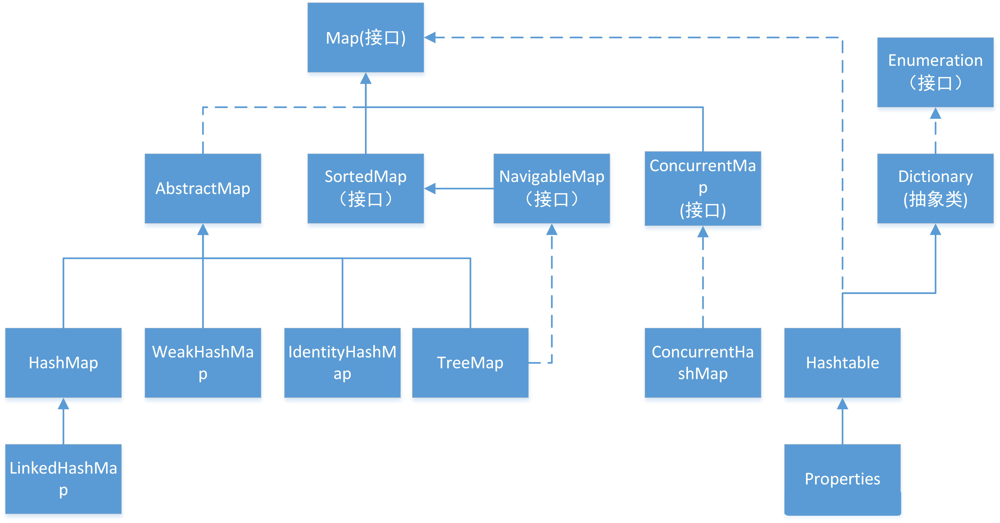

# 简介
Map是将键映射到值( key-value )的对象。
一个映射不能包含重复的键；每个键最多只能映射到一个值。
Map 接口提供三种collection 视图，允许以键集(keySet())、值集(values())或
键-值映射关系集(entrySet())的形式查看某个映射的内容( 即获取键值对的内容 )。

映射顺序定义为迭代器在映射的 collection 视图上返回其元素的顺序,
即可以映射得到键、值和键-值的Set集合，元素的顺序是由得到的Set集合所决定的。
某些映射实现可明确保证其顺序，如 TreeMap 类；另一些映射实现则不保证顺序，如 HashMap 类 。

简单来说Map中的有序指的是：存入键值对的顺序和顺序遍历得到的元素的顺序相同；
而无序则是不一定存入和遍历的顺序相同。

Map的层次如下：



# 接口和抽象类说明
- Map
Map是一个接口，Map中存储的内容是键值对（key-value）。

-  AbstractMap
实现一个用于帮助实现您自己的 Map 类的抽象类

- SortedMap
SortedMap也是一个接口，它继承与Map接口。
SortedMap中的内容与Map中的区别在于，它是有序的键值对，里面排序的方法是通过比较器（Comparator）实现的。

- NavigableMap
NavigableMap也是一个接口，它继承与SortedMap接口，所以它肯定也是有序的，
另外，NavigableMap还有一些导航的方法：如获取“大于或等于某个对象的键值对”等等。

- Enumeration
Enumeration接口中定义了一些方法，通过这些方法可以枚举（一次获得一个）对象集合中的元素。
这种传统接口已被迭代器取代，虽然Enumeration 还未被遗弃，但在现代代码中已经被很少使用了。
尽管如此，它还是使用在诸如Vector和Properties这些传统类所定义的方法中.
一些Enumeration声明的方法：

| 方法名称 | 说明 |
| -- | -- |
| boolean hasMoreElements( ) | 测试此枚举是否包含更多的元素 |
| Object nextElement( ) | 如果此枚举对象至少还有一个可提供的元素，则返回此枚举的下一个元素。|

```java
//枚举遍历示例
public static void main(String args[]) {
      Enumeration<String> days;
      Vector<String> dayNames = new Vector<String>();
      dayNames.add("Sunday");
      dayNames.add("Monday");
      dayNames.add("Tuesday");
      dayNames.add("Wednesday");
      dayNames.add("Thursday");
      dayNames.add("Friday");
      dayNames.add("Saturday");
      days = dayNames.elements();
      while (days.hasMoreElements()){
         System.out.println(days.nextElement());
      }
   }
```

- Dictionary
Dictionary 类是一个抽象类，用来存储键/值对，作用和Map类相似。
给出键和值，你就可以将值存储在Dictionary对象中。
一旦该值被存储，就可以通过它的键来获取它。所以和Map一样， Dictionary 也可以作为一个键/值对列表。
Dictionary定义的抽象方法如下表所示：

序号 |  方法 | 描述
-- | -- | -- | --
1 | Enumeration elements( ) | 返回此 dictionary 中值的枚举。
2 | Object get(Object key) | 返回此 dictionary 中该键所映射到的值。
3 | boolean isEmpty( ) | 测试此 dictionary 是否不存在从键到值的映射。
4 | Enumeration keys( ) | 返回此 dictionary 中的键的枚举。
5 | Object put(Object key, Object value) | 将指定 key 映射到此 dictionary 中指定 value。
6 | Object remove(Object key) | 从此 dictionary 中移除 key （及其相应的 value）。
7 | int size( ) | 返回此 dictionary 中条目（不同键）的数量。

Dictionary类已经过时了，Map接口可以理解为是Dictionary的替代者。

# 常见的Map和原理

## 通用Map
通用 Map，用于在应用程序中管理映射，通常在 java.util 程序包中实现

### HashMap
HashMap是基于哈希表的Map接口实现，为线程不安全，且是无序的。
HashMap在java7以前都是用一个Entry数组，数组中是Entry链表的头节点的方式存储数据。
HashMap在java7以及之后才用“数组”+链表+红黑树的方式实现，这里说下java7以前的实现。

- 底层实现原理

1.其内部有一个叫做table的的Entry数组。Entry是其一个静态内部类，存储键值对。
而table数组的大小默认是16，可以初始化指定大小。Entry的数据结构是一个链表。
Entry 的定义：
```java
static class Entry implements Map.Entry
{
        final K key;
        V value;
        Entry next;
        final int hash;
}  
```
2.每当往hashmap里面存放key-value对的时候，都会为它们实例化一个Entry对象，
然后根据key的hashcode()方法计算出来的hash值（来决定）来
计算出此key在Entry数组的索引，然后根据索引将第键值对加入到此索引下的Entry的尾部，
如果找到key相同的(equals相等)，则替换其Entry中的value的值。
所以HashMap中的值是不能够重复的。

3.对key做null检查。如果key是null，会被存储到table[0]，所以null的hash值总是0。

4.table的索引在逻辑上叫做“桶”(bucket)，这个索引位置的值存储了链表的第一个元素。

5.key的hashcode()方法用来找到Entry对象所在的桶。

6.如果两个key有相同的hash值，他们会被放在table数组的同一个桶里面。

7.key的equals()方法用来确保key的唯一性。

8.value对象的equals()和hashcode()在hashMap中没有用到。

- 源码查看
构造方法：
```java
// 指定“初始容量大小”和“加载因子”的构造函数
public HashMap(int initialCapacity, float loadFactor) {
        if (initialCapacity < 0)
            throw new IllegalArgumentException("Illegal initial capacity: " +
                                               initialCapacity);
        if (initialCapacity > MAXIMUM_CAPACITY)
            initialCapacity = MAXIMUM_CAPACITY;
        if (loadFactor <= 0 || Float.isNaN(loadFactor))
            throw new IllegalArgumentException("Illegal load factor: " +
                                               loadFactor);
        // Find a power of 2 >= initialCapacity
        int capacity = 1; 
        //当capacity 的值小于initialCapacity时，循环，用位移运算将capacity 
       //的值扩大至原来的2倍，直到capacity 不小于initialCapacity。
        while (capacity < initialCapacity)
            capacity <<= 1;
        this.loadFactor = loadFactor;
        threshold = (int)Math.min(capacity * loadFactor, MAXIMUM_CAPACITY + 1);
        table = new Entry[capacity]; //这里建立Entry的数组来存储Entry，而Entry中存储具体的键值对
        useAltHashing = sun.misc.VM.isBooted() &&
                (capacity >= Holder.ALTERNATIVE_HASHING_THRESHOLD);
        init();
}
```
put方法：

```java
/**
     * Associates the specified value with the specified key in this map.
     * If the map previously contained a mapping for the key, the old
     * value is replaced.
     *
     * @param key key with which the specified value is to be associated
     * @param value value to be associated with the specified key
     * @return the previous value associated with <tt>key</tt>, or
     * <tt>null</tt> if there was no mapping for <tt>key</tt>.
     * (A <tt>null</tt> return can also indicate that the map
     * previously associated <tt>null</tt> with <tt>key</tt>.)
     */
public V put(K key, V value) {
        //其允许存放null的key和null的value，当其key为null时，调用putForNullKey方法，放入到table[0]的这个位置
        if (key == null)
            return putForNullKey(value);
        //通过调用hash方法对key进行哈希，得到哈希之后的数值,其目的是为了尽可能的让键值对可以分不到不同的桶中 
        int hash = hash(key);
        //根据上一步骤中求出的hash得到在数组中是索引
        int i = indexFor(hash, table.length);
        //如果i处的Entry不为null，则通过其next指针不断遍历e元素的下一个元素。
        for (Entry<K,V> e = table[i]; e != null; e = e.next) {
            Object k;
            if (e.hash == hash && ((k = e.key) == key || key.equals(k))) {
                V oldValue = e.value;
                e.value = value;
                e.recordAccess(this);
                return oldValue;
            }
        }
        modCount++;
        addEntry(hash, key, value, i);
        return null;
}
```

addEntry方法：
```java
/**
     * Adds a new entry with the specified key, value and hash code to
     * the specified bucket. It is the responsibility of this
     * method to resize the table if appropriate.
     *
     * Subclass overrides this to alter the behavior of put method.
     */
void addEntry(int hash, K key, V value, int bucketIndex) {
        if ((size >= threshold) && (null != table[bucketIndex])) {
            resize(2 * table.length);
            hash = (null != key) ? hash(key) : 0;
            bucketIndex = indexFor(hash, table.length);
        }
        createEntry(hash, key, value, bucketIndex);
}
void createEntry(int hash, K key, V value, int bucketIndex) {
        // 获取指定 bucketIndex 索引处的 Entry
        Entry<K,V> e = table[bucketIndex];
        // 将新创建的 Entry 放入 bucketIndex 索引处，并让新的 Entry 指向原来的 Entr
        table[bucketIndex] = new Entry<>(hash, key, value, e);
        size++;
}
```

hash方法：
hash(int h)方法根据 key 的 hashCode 重新计算一次散列。
此算法加入了高位计算；防止低位不变，高位变化时，造成的 hash 冲突。
```java
final int hash(Object k) {
        int h = 0;
        if (useAltHashing) {
            if (k instanceof String) {
                return sun.misc.Hashing.stringHash32((String) k);
            }
            h = hashSeed;
        }
        //得到k的hashcode值
        h ^= k.hashCode();
        //进行计算
        h ^= (h >>> 20) ^ (h >>> 12);
        return h ^ (h >>> 7) ^ (h >>> 4);
}
```
indexFor方法：
indexFor(int h, int length)用来计算该对象应该保存在 table 数组的哪个索引处。
```java
/**
     * Returns index for hash code h.
     */
static int indexFor(int h, int length) {
    return h & (length-1);
}
```
它通过 h & (table.length -1) 来得到该对象的保存位，而 HashMap 底层数组的长度总是 2 的 n 次方，
这是 HashMap 在速度上的优化。在 HashMap 构造器中有如下代码：
```java
// Find a power of 2 >= initialCapacity
int capacity = 1;
    while (capacity < initialCapacity)
        capacity <<= 1;
```
这段代码保证初始化时 HashMap 的容量总是 2 的 n 次方，即底层数组的长度总是为 2 的 n 次方。
当 length 总是 2 的 n 次方时，h& (length-1)运算等价于对 length 取模，也就是 h%length，但是 & 比 % 具有更高的效率。

get方法：
```java
/**
     * Returns the value to which the specified key is mapped,
     * or {@code null} if this map contains no mapping for the key.
     *
     * <p>More formally, if this map contains a mapping from a key
     * {@code k} to a value {@code v} such that {@code (key==null ? k==null :
     * key.equals(k))}, then this method returns {@code v}; otherwise
     * it returns {@code null}. (There can be at most one such mapping.)
     *
     * <p>A return value of {@code null} does not <i>necessarily</i>
     * indicate that the map contains no mapping for the key; it's also
     * possible that the map explicitly maps the key to {@code null}.
     * The {@link #containsKey containsKey} operation may be used to
     * distinguish these two cases.
     *
     * @see #put(Object, Object)
     */
    public V get(Object key) {
        if (key == null)
            return getForNullKey();
        Entry<K,V> entry = getEntry(key);
        return null == entry ? null : entry.getValue();
    }
    final Entry<K,V> getEntry(Object key) {
        int hash = (key == null) ? 0 : hash(key);
        for (Entry<K,V> e = table[indexFor(hash, table.length)];
             e != null;
             e = e.next) {
            Object k;
            if (e.hash == hash &&
                ((k = e.key) == key || (key != null && key.equals(k))))
                return e;
        }
        return null;
    }
```

resize（rehash）方法：
HashMap 的 当 HashMap 中的元素越来越多的时候，hash 冲突的几率也就越来越高，因为数组的长度是固定的。
所以为了提高查询的效率，就要对 HashMap 的数组进行扩容；
而在 HashMap 数组扩容是最消耗性能的，因为原数组中的数据必须重新计算其在新数组中的位置，并放进去，这就是 resize。

当 HashMap 中的元素个数超过数组大小 \* loadFactor时，就会进行数组扩容，
loadFactor的默认值为 0.75，也就是说，默认情况下，数组大小为 16，
那么当 HashMap 中元素个数超过 16 \* 0.75=12 的时候，就把数组的大小扩展为 2\*16=32，
即扩大一倍，然后重新计算每个元素在数组中的位置；
所以如果我们已经预知 HashMap 中元素的个数，那么预设元素的个数能够有效的提高 HashMap 的性能。

**注意：**

HashMap中，null可以作为键，这样的键只有一个；可以有一个或多个键所对应的值为null。
当get()方法返回null值时，可能是 HashMap中没有该键，也可能使该键所对应的值为null。
因此，在HashMap中不能由get()方法来判断HashMap中是否存在某个键， 而应该用containsKey()方法来判断。

### Hashtable
Hashtable 也是一个散列表，它存储的内容是键值对(key-value)映射。
**Hashtable 继承于Dictionary，实现了Map、Cloneable、java.io.Serializable接口**
**Hashtable 的函数都是同步的，这意味着它是线程安全的**
**它的key、value都不可以为null，Hashtable中的映射不是有序的 。**
其构造函数同HashMap：

```java
//通过初始容量和加载因子(默认0.75)
public Hashtable(int initialCapacity, float loadFactor)
```
HashTable的实现大致与HashMap相同，区别如下：

1.HashMap把Hashtable的contains方法去掉了，改成containsValue和containsKey，
因为contains方法容易让人引起误解。
Hashtable则保留了contains，containsValue和containsKey三个方法，
其中contains和containsValue功能相同。

2.HashTable是线程安全的，而HashMap不是。

3.HashTable的键和值都不能是Null，而HashMap得键和值都可以是null。

4.HashMap的迭代器(Iterator)是fail-fast迭代器，而Hashtable的enumerator迭代器不是fail-fast的。
所以当有其它线程改变了HashMap的结构（增加或者移除元素），将会抛出ConcurrentModificationException，
但迭代器本身的remove()方法移除元素则不会抛出ConcurrentModificationException异常。
但这并不是一个一定发生的行为，要看JVM。这条同样也是Enumeration和Iterator的区别。

5.Hashtable中hash数组默认大小是11，增加的方式是 old*2+1。
HashMap中hash数组的默认大小是16，而且扩容后容量一定是2的指数。

6.HashTbale是用的hashcode进行 模运算（%取余的方式），
```java
int hash = key.hashCode();
int index = (hash & 0x7FFFFFFF) % tab.length;
```
而HashMap是强制容量为2的幂，重新根据hashcode计算hash值，
在使用hash 位与 （hash表长度 – 1），也等价取模，
HashMap更加高效，取得的位置更加分散，偶数，奇数保证了都会分散到。

### Properties
Properties继承自HashTable，是线程安全的，其键值不能是Null。。
Properties支持文本方式和xml方式的数据存储读取。
在文本方式中，格式为key:value,其中分隔符可以是：冒号(:)、等号(=)、空格。
其中空格可以作为key的结束，同时获取的值会将分割符号两端的空格去掉。

Properties类常用来读取纯文本配置文件，后缀名一般为(.properties)，
且其只支持编码是ASCII的内容(所以需要转码，或者用其余的配置读取方式)。
load(InputStream):从byte stream中加载key/value键值对，
要求所有的key/value键值对是按行存储，同时是用ISO-8859-1编译的。
文件的内容格式为“key=value”，文本注释可以使用"#"或者感叹号"!"来注释。
配置文件示例：
```properties
#配置文件示例
key=test
name=测试内容
```
- 初始化
Properties提供两种方式来创建Properties对象，第一种是不指定默认values对象的创建方法，
另外一种是指定默认values对象的创建方法。
但是此时是没有加载属性值的，加载key/value属性必须通过专门的方法来加载。
```java
/**
     * Creates an empty property list with no default values.
     */
    public Properties() {
        this(null);
    }
    /**
     * Creates an empty property list with the specified defaults.
     *
     * @param defaults the defaults.
     */
    public Properties(Properties defaults) {
        this.defaults = defaults;
    }

```

load方法：
```java
/**
     * Reads a property list (key and element pairs) from the input
     * byte stream. The input stream is in a simple line-oriented
     * format as specified in
     * {@link #load(java.io.Reader) load(Reader)} and is assumed to use
     * the ISO 8859-1 character encoding; that is each byte is one Latin1
     * character. Characters not in Latin1, and certain special characters,
     * are represented in keys and elements using Unicode escapes as defined in
     * section 3.3 of
     * <cite>The Java&trade; Language Specification</cite>.
     * <p>
     * The specified stream remains open after this method returns.
     *
     * @param inStream the input stream.
     * @exception IOException if an error occurred when reading from the
     * input stream.
     * @throws IllegalArgumentException if the input stream contains a
     * malformed Unicode escape sequence.
     * @since 1.2
     */
    public synchronized void load(InputStream inStream) throws IOException {
        load0(new LineReader(inStream));
    }

```

LineReader :
```java
class LineReader {
        /**
         * 根据字节流创建LineReader对象
         *
         * @param inStream
         * 属性键值对对应的字节流对象
         */
        public LineReader(InputStream inStream) {
            this.inStream = inStream;
            inByteBuf = new byte[8192];
        }
        /**
         * 根据字符流创建LineReader对象
         *
         * @param reader
         * 属性键值对对应的字符流对象
         */
        public LineReader(Reader reader) {
            this.reader = reader;
            inCharBuf = new char[8192];
        }
        // 字节流缓冲区, 大小为8192个字节
        byte[] inByteBuf;
        // 字符流缓冲区，大小为8192个字符
        char[] inCharBuf;
        // 当前行信息的缓冲区，大小为1024个字符
        char[] lineBuf = new char[1024];
        // 读取一行数据时候的实际读取大小
        int inLimit = 0;
        // 读取的时候指向当前字符位置
        int inOff = 0;
        // 字节流对象
        InputStream inStream;
        // 字符流对象
        Reader reader;
        /**
         * 读取一行，将行信息保存到{@link lineBuf}对象中，并返回实际的字符个数
         *
         * @return 实际读取的字符个数
         * @throws IOException
         */
        int readLine() throws IOException {
            // 总的字符长度
            int len = 0;
            // 当前字符
            char c = 0;
            boolean skipWhiteSpace = true;
            boolean isCommentLine = false;
            boolean isNewLine = true;
            boolean appendedLineBegin = false;
            boolean precedingBackslash = false;
            boolean skipLF = false;
            while (true) {
                if (inOff >= inLimit) {
                    // 读取一行数据，并返回这一行的实际读取大小
                    inLimit = (inStream == null) ? reader.read(inCharBuf) : inStream.read(inByteBuf);
                    inOff = 0;
                    // 如果没有读取到数据，那么就直接结束读取操作
                    if (inLimit <= 0) {
                        // 如果当前长度为0或者是改行是注释，那么就返回-1。否则返回len的值。
                        if (len == 0 || isCommentLine) {
                            return -1;
                        }
                        return len;
                    }
                }
                // 判断是根据字符流还是字节流读取当前字符
                if (inStream != null) {
                    // The line below is equivalent to calling a ISO8859-1 decoder.
                    // 字节流是根据ISO8859-1进行编码的，所以在这里进行解码操作。
                    c = (char) (0xff & inByteBuf[inOff++]);
                } else {
                    c = inCharBuf[inOff++];
                }
                // 如果前一个字符是换行符号，那么判断当前字符是否也是换行符号
                if (skipLF) {
                    skipLF = false;
                    if (c == '\n') {
                        continue;
                    }
                }
                // 如果前一个字符是空格，那么判断当前字符是不是空格类字符
                if (skipWhiteSpace) {
                    if (c == ' ' || c == '\t' || c == '\f') {
                        continue;
                    }
                    if (!appendedLineBegin && (c == '\r' || c == '\n')) {
                        continue;
                    }
                    skipWhiteSpace = false;
                    appendedLineBegin = false;
                }
                // 如果当前新的一行，那么进入该if判断中
                if (isNewLine) {
                    isNewLine = false;
                    // 如果当前字符是#或者是!，那么表示该行是一个注释行
                    if (c == '#' || c == '!') {
                        isCommentLine = true;
                        continue;
                    }
                }
                // 根据当前字符是不是换行符号进行判断操作
                if (c != '\n' && c != '\r') {
                    // 当前字符不是换行符号
                    lineBuf[len++] = c;// 将当前字符写入到行信息缓冲区中，并将len自增加1.
                    // 如果len的长度大于行信息缓冲区的大小，那么对lineBuf进行扩容，扩容大小为原来的两倍，最大为Integer.MAX_VALUE
                    if (len == lineBuf.length) {
                        int newLength = lineBuf.length * 2;
                        if (newLength < 0) {
                            newLength = Integer.MAX_VALUE;
                        }
                        char[] buf = new char[newLength];
                        System.arraycopy(lineBuf, 0, buf, 0, lineBuf.length);
                        lineBuf = buf;
                    }
                    // 是否是转义字符
                    // flip the preceding backslash flag
                    if (c == '\\') {
                        precedingBackslash = !precedingBackslash;
                    } else {
                        precedingBackslash = false;
                    }
                } else {
                    // reached EOL
                    if (isCommentLine || len == 0) {
                        // 如果这一行是注释行，或者是当前长度为0，那么进行clean操作。
                        isCommentLine = false;
                        isNewLine = true;
                        skipWhiteSpace = true;
                        len = 0;
                        continue;
                    }
                    // 如果已经没有数据了，就重新读取
                    if (inOff >= inLimit) {
                        inLimit = (inStream == null) ? reader.read(inCharBuf) : inStream.read(inByteBuf);
                        inOff = 0;
                        if (inLimit <= 0) {
                            return len;
                        }
                    }
                    // 查看是否是转义字符
                    if (precedingBackslash) {
                        // 如果是，那么表示是另起一行，进行属性的定义，len要自减少1.
                        len -= 1;
                        // skip the leading whitespace characters in following line
                        skipWhiteSpace = true;
                        appendedLineBegin = true;
                        precedingBackslash = false;
                        if (c == '\r') {
                            skipLF = true;
                        }
                    } else {
                        return len;
                    }
                }
            }
        }
    }
```
我们可以看出一些特征：readLine这个方法每次读取一行数据；如果我们想在多行写数据，那么可以使用'\'来进行转义，在该转义符号后面换行，是被允许的。

load0方法：
```java
private void load0(LineReader lr) throws IOException {
        char[] convtBuf = new char[1024];
        // 读取的字符总数
        int limit;
        // 当前key所在位置
        int keyLen;
        // value的起始位置
        int valueStart;
        // 当前字符
        char c;
        //
        boolean hasSep;
        // 是否是转义字符
        boolean precedingBackslash;
        while ((limit = lr.readLine()) >= 0) {
            c = 0;
            // key的长度
            keyLen = 0;
            // value的起始位置默认为limit
            valueStart = limit;
            //
            hasSep = false;
            precedingBackslash = false;
            // 如果key的长度小于总的字符长度，那么就进入循环
            while (keyLen < limit) {
                // 获取当前字符
                c = lr.lineBuf[keyLen];
                // 如果当前字符是=或者是:，而且前一个字符不是转义字符，那么就表示key的描述已经结束
                if ((c == '=' || c == ':') && !precedingBackslash) {
                    // 指定value的起始位置为当前keyLen的下一个位置
                    valueStart = keyLen + 1;
                    // 并且指定，去除空格
                    hasSep = true;
                    break;
                } else if ((c == ' ' || c == '\t' || c == '\f') && !precedingBackslash) {
                    // 如果当前字符是空格类字符，而且前一个字符不是转义字符，那么表示key的描述已经结束
                    // 指定value的起始位置为当前位置的下一个位置
                    valueStart = keyLen + 1;
                    break;
                }
                // 如果当前字符为'\'，那么跟新是否是转义号。
                if (c == '\\') {
                    precedingBackslash = !precedingBackslash;
                } else {
                    precedingBackslash = false;
                }
                keyLen++;
            }
            // 如果value的起始位置小于总的字符长度，那么就进入该循环
            while (valueStart < limit) {
                // 获取当前字符
                c = lr.lineBuf[valueStart];
                // 判断当前字符是否是空格类字符，达到去空格的效果
                if (c != ' ' && c != '\t' && c != '\f') {
                    // 当前字符不是空格类字符，而且当前字符为=或者是:，并在此之前没有出现过=或者:字符。
                    // 那么value的起始位置继续往后移动。
                    if (!hasSep && (c == '=' || c == ':')) {
                        hasSep = true;
                    } else {
                        // 当前字符不是=或者:，或者在此之前出现过=或者:字符。那么结束循环。
                        break;
                    }
                }
                valueStart++;
            }
            // 读取key
            String key = loadConvert(lr.lineBuf, 0, keyLen, convtBuf);
            // 读取value
            String value = loadConvert(lr.lineBuf, valueStart, limit - valueStart, convtBuf);
            // 包括key/value
            put(key, value);
        }
    }
```
我们可以看到，在这个过程中，会将分割符号两边的空格去掉，并且分**割符号可以是=,:,空格等。**
**而且=和:的级别比空格分隔符高，即当这两个都存在的情况下，是按照=/:分割的。**
可以看到在最后会调用一个loadConvert方法，该方法主要是做key/value的读取，并将十六进制的字符进行转换。

loadFromXML：
该方法主要是提供一个从XML文件中读取key/value键值对的方法。
底层是调用的XMLUtil的方法，加载完对象属性后，流会被显示的关闭。
xml格式如下所示：
```java
<?xml version="1.0" encoding="UTF-8" standalone="no"?>
<!DOCTYPE properties SYSTEM "http://java.sun.com/dtd/properties.dtd">
<properties>
<comment>comments</comment>
<entry key="key7">value7</entry>
<entry key="key6">value7</entry>
<entry key="key4">value4 </entry>
<entry key="key3">vlaue3</entry>
<entry key="key2">value2</entry>
<entry key="key1">value1</entry>
</properties>
```

Properties继承的是HashTable,当setProperties的时候，利用的是HashTable的put进行存储。
当我们store配置信息到文件中的时候，直接将内存中的key、value全部存储到文件中。

store(InputStream/Reader,String)方法 :
该方法主要是将属性值写出到文本文件中，并写出一个comment的注释。
底层调用的是store0方法。针对store(InputStream,String)方法，在调用store0方法的时候，
进行字节流封装成字符流，并且指定字符集为8859-1。源码如下：
```java
private void store0(BufferedWriter bw, String comments, boolean escUnicode) throws IOException {
        if (comments != null) {
            // 写出注释, 如果是中文注释，那么转化成为8859-1的字符
            writeComments(bw, comments);
        }
        // 写出时间注释
        bw.write("#" + new Date().toString());
        // 新起一行
        bw.newLine();
        // 进行线程间同步的并发控制
        synchronized (this) {
            for (Enumeration e = keys(); e.hasMoreElements();) {
                String key = (String) e.nextElement();
                String val = (String) get(key);
                // 针对空格进行转义，并根据是否需要进行8859-1编码
                key = saveConvert(key, true, escUnicode);
                /*
                 * No need to escape embedded and trailing spaces for value,
                 * hence pass false to flag.
                 */
                // value不对空格进行转义
                val = saveConvert(val, false, escUnicode);
                // 写出key/value键值对
                bw.write(key + "=" + val);
                bw.newLine();
            }
        }
        bw.flush();
    }
```

常用读取方式：
```java
  Properties prop = new Properties();
 InputStream in = Test.class.getClassLoader().getResourceAsStream( "test.properties"); 
  prop.load(in);
```
getClassLoader().getResourceAsStream()方法直接获得字节输入流，这种方式不用考虑路径中是否包含中文的问题。
getClassLoader().getResource()方法，因为该方法返回值是URL，如果项目的目录中有中文命名，
则获得的URL会出现乱码，所以使用
```java
String path=URLDecoder.decode(url.getFile(), "utf-8");
```

### LinkedHashMap
LinkedHashMap是HashMap的子类，所以其实有很多地方类似。
其不同点主要如下：
1.LinkedHashMap是有序的，而HashMap不一定有序。

- 实现
**LinkedHashMap除了将元素用HashMap方式存储外，还将所有Entry节点链入一个双向链表中。**
Entry双向链表中的数据是HashMap中链表数据的引用，即没有额外生成新元素，只是扩展了Entry加入的引用字段。
因此对于每次put进来Entry，除了将其保存到哈希表中对应的位置上之外，还会将其插入到双向链表的尾部。
同时类里有两个成员变量head tail,分别指向内部双向链表的表头、表尾。
```java
//双向链表的头结点
transient LinkedHashMap.Entry<K,V> head;
//双向链表的尾节点
transient LinkedHashMap.Entry<K,V> tail;
```

LinkedHashMap中的Entry属性：
属性 | 名称
-- | --
hash，key ，value ，next | 同HashMap中的桶中的Entry节点中的属性
before，after | LinkedHashMap中扩展的属性，用于维护双向链表的顺序

注意：
next用于维护HashMap各个桶中Entry的连接顺序，before、after用于维护Entry插入的先后顺序。

LinkedHashMap的LRU算法支持：
**使用LinkedHashMap实现LRU的必要前提是将accessOrder标志位设为true以便开启按访问顺序排序的模式。**
```java
/**
     * This override alters behavior of superclass put method. It causes newly
     * allocated entry to get inserted at the end of the linked list and
     * removes the eldest entry if appropriate.
     *
     * LinkedHashMap中的addEntry方法
     */
    void addEntry(int hash, K key, V value, int bucketIndex) {
        //创建新的Entry，并插入到LinkedHashMap中
        createEntry(hash, key, value, bucketIndex); // 重写了HashMap中的createEntry方法
        //双向链表的第一个有效节点（header后的那个节点）为最近最少使用的节点，这是用来支持LRU算法的
        Entry<K,V> eldest = header.after;
        //如果有必要，则删除掉该近期最少使用的节点，
        //这要看对removeEldestEntry的覆写,由于默认为false，因此默认是不做任何处理的。
        if (removeEldestEntry(eldest)) {
            removeEntryForKey(eldest.key);
        } else {
            //扩容到原来的2倍
            if (size >= threshold)
                resize(2 * table.length);
        }
    }
    void createEntry(int hash, K key, V value, int bucketIndex) {
        // 向哈希表中插入Entry，这点与HashMap中相同
        //创建新的Entry并将其链入到数组对应桶的链表的头结点处，
        HashMap.Entry<K,V> old = table[bucketIndex];
        Entry<K,V> e = new Entry<K,V>(hash, key, value, old);
        table[bucketIndex] = e;
        //在每次向哈希表插入Entry的同时，都会将其插入到双向链表的尾部，
        //这样就按照Entry插入LinkedHashMap的先后顺序来迭代元素(LinkedHashMap根据双向链表重写了迭代器)
        //同时，新put进来的Entry是最近访问的Entry，把其放在链表末尾 ，也符合LRU算法的实现
        e.addBefore(header);
        size++;
    }
```
removeEldestEntry方法：
```java
 protected boolean removeEldestEntry(Map.Entry<K,V> eldest) {
        return false;
    }
```
当其值返回true的时候，在调用的addEntry方法中便会将近期最少使用的节点删除掉（header后的那个节点）。
实际上是因为在put数据的时候会改变双向链表的顺序，是最新的数据放置到链表尾部。
而开启accessOrder后，访问数据时同样会将最新的数据放置到链表尾部。
即不开启accessOrder时遍历双向链表中的顺序就是插入顺序，而开始后则是数据的增删改查后更新的顺序。
依次循环会导致最不常用的数据下沉到header后面的那个节点。

containsValue方法：
LinkedHashMap重写了containsValue方法，相比HashMap的实现，更为高效。
```java
    public boolean containsValue(Object value) {
        //遍历一遍链表，去比较有没有value相等的节点，并返回
        for (LinkedHashMap.Entry<K,V> e = head; e != null; e = e.after) {
            V v = e.value;
            if (v == value || (value != null && value.equals(v)))
                return true;
        }
        return false;
    }
```
而HashMap的containsValue，是用两个for循环遍历，相对低效。
```java
    public boolean containsValue(Object value) {
        Node<K,V>[] tab; V v;
        if ((tab = table) != null && size > 0) {
            for (int i = 0; i < tab.length; ++i) {
                for (Node<K,V> e = tab[i]; e != null; e = e.next) {
                    if ((v = e.value) == value ||
                        (value != null && value.equals(v)))
                        return true;
                }
            }
        }
        return false;
    }
```

### IdentityHashMap
IdentityHashMap由于平常使用的较少，所以这里简单介绍下：

- 功能
IdentityHashMap通用存放键值对，规则是当两个Key引用的对象完全相等(即用 == 符号判断返回true时)
时，才会这更新/删除对应的值。HashMap是用的equals方法作为对比。

IdentityHashMap的层次：
```java
public class IdentityHashMap<K,V>
    extends AbstractMap<K,V>
    implements Map<K,V>, java.io.Serializable, Cloneable
```

IdentityHashMap中同样可以存放键或值是null的数据。
```java
@Test
    public void identityHashMapTest(){
        IdentityHashMap idMap = new IdentityHashMap();
        idMap.put(null,null);
        idMap.put(516,null);
        idMap.put(null,123);
        idMap.forEach( (K,V)->{
            System.out.println(K + " : " + V);
        });
    }
```

- 实现原理
**IdentityHashMap的底层是一个Object数组，并且直接用此Object数组来保存键值数据。 **
其保存方式是，用hash计算的数组索引来得到key，在保存key的位置的下一个位置来保存此key对应的值。
其默认数组长度是32，最小长度4，最大长度2的29次方。

其初始化和扩容时默认将会数组大小调整为2的n次方-1的长度，这点和HashMap中的一样，
可以利用位运算＆来进行快速取模运算，得到其键的hash值对应的数组的索引。

如果索引冲突，那么从当前数组所在位置向后遍历找到没使用的数组节点，在找到数组尾部后
仍然没找到的话，则从数组头部开始再次遍历，直到找到空位置。

如果在put时，发现当前数据数量(即键值对的数量，一个键值对算一个) 乘以3的长度大于数组长度，
则会对原数组进行扩容，同时重新计算hash和进行值拷贝。
默认扩容后的数组长度是原长度的2倍。

其对于Key是Null的数据，会有一个定义好的Key来替代Null作为Key保存数据。
```java
public class IdentityHashMap<K,V>
    extends AbstractMap<K,V>
    implements Map<K,V>, java.io.Serializable, Cloneable
{
    // 缺省容量大小
    private static final int DEFAULT_CAPACITY = 32;
    // 最小容量
    private static final int MINIMUM_CAPACITY = 4;
    // 最大容量
    private static final int MAXIMUM_CAPACITY = 1 << 29;
    // 用于存储实际元素的表
    transient Object[] table;
    // 大小
    int size;
    // 对Map进行结构性修改的次数
    transient int modCount;
    // null key所对应的值
    static final Object NULL_KEY = new Object();
}
```

put方法：
```java
public V put(K key, V value) {
        // 保证null的key会转化为Object(NULL_KEY)
        final Object k = maskNull(key);
        retryAfterResize: for (;;) {
            final Object[] tab = table;
            final int len = tab.length;
            int i = hash(k, len);
            for (Object item; (item = tab[i]) != null;
                 i = nextKeyIndex(i, len)) {
                if (item == k) { // 经过hash计算的项与key相等
                    @SuppressWarnings("unchecked")
                        // 取得值
                        V oldValue = (V) tab[i + 1];
                    // 将value存入
                    tab[i + 1] = value;
                    // 返回旧值
                    return oldValue;
                }
            }
            // 大小加1
            final int s = size + 1;
            // Use optimized form of 3 * s.
            // Next capacity is len, 2 * current capacity.
            // 如果3 * size大于length，则会进行扩容操作
            if (s + (s << 1) > len && resize(len))
                // 扩容后重新计算元素的值，寻找合适的位置进行存放
                continue retryAfterResize;
            // 结构性修改加1
            modCount++;
            // 存放key与value
            tab[i] = k;
            tab[i + 1] = value;
            // 更新size
            size = s;
            return null;
        }
    }
```

- remove方法
删除对应的键值(实际上是键值对的size--，以及把对应索引的引用对象置为null)后需要进行后续处理，
把之前由于冲突往后挪的元素移到前面来(所以不冲突的元素位置仍然不动)。

### TreeMap
TreeMap的数据存储时基于红黑树的结构来存储键值对,
所以TreeMap是会自动对key进行排序（次序由Comparable或Comparator决定）。

1.TreeMap是根据key进行排序的，它的排序和定位需要依赖比较器或覆写Comparable接口，
也因此不需要key覆写hashCode方法和equals方法，就可以排除掉重复的key，
而HashMap的key则需要通过覆写hashCode方法和equals方法来确保没有重复的key。

2.TreeMap的查询、插入、删除效率均没有HashMap高，一般只有要对key排序时才使用TreeMap。

3.TreeMap的key不能为null，而HashMap的key可以为null。

实现Comparable结构的类可以和其他对象进行比较，即实现Comparable可以进行比较的类。
而实现Comparator接口的类是比较器，用于比较两个对象的大小。

笔者这里不分析相关算法，有兴趣可以查看：
红黑树 资料：https://www.cnblogs.com/CarpenterLee/p/5503882.html
常见树形数据结构：https://zhuanlan.zhihu.com/p/27700617

### WeakHashMap
WeakHashMap适用于作为缓存Map，这样当内存不够时，其会自动回收内存来压缩缓存空间，
而不会导致内存溢出现象。

weakHashMap的继承关系：
```java
java.lang.Object
   ↳ java.util.AbstractMap<K, V>
         ↳ java.util.WeakHashMap<K, V>
public class WeakHashMap<K,V>
    extends AbstractMap<K,V>
    implements Map<K,V> {}
```

WeakHashMap中使用一个Entry数组中装载Entry链表头节点的方式来保存数据。
所以当remove(实际上就是删除链表中的某个节点)后，链表的引用不在存在。
put方法返回旧值，实际上也是替换原值或者插入Entry节点到Entry数组中。

WeakHashMap其键值可以是Null。

其实现大致和HashMap相同，但是增加了一个ReferenceQueue<K> queue，来保存被java虚拟机收回的对象的虚引用。
如果弱引用所引用的对象被垃圾回收，Java虚拟机就会把这个弱引用加入到与之关联的引用队列中。
接着，WeakHashMap会根据“引用队列”，来删除“WeakHashMap中已被GC回收的‘弱键’对应的键值对”。

其初始容量是16，最大长度是2的30次方，扩容因子是0.75，扩容时容量变为原来的2倍。
由于
```java
    public class WeakHashMap<K,V> 
    extends AbstractMap<K,V>
    implements Map<K,V> {
    // 默认的初始容量是16，必须是2的幂。
    private static final int DEFAULT_INITIAL_CAPACITY = 16;
    // 最大容量（必须是2的幂且小于2的30次方，传入容量过大将被这个值替换）
    private static final int MAXIMUM_CAPACITY = 1 << 30;
    // 默认加载因子
    private static final float DEFAULT_LOAD_FACTOR = 0.75f;
    // 存储数据的Entry数组，长度是2的幂。
    // WeakHashMap是采用拉链法实现的，每一个Entry本质上是一个单向链表
    private Entry[] table;
    // WeakHashMap的大小，它是WeakHashMap保存的键值对的数量
    private int size;
    // WeakHashMap的阈值，用于判断是否需要调整WeakHashMap的容量（threshold = 容量*加载因子）
    private int threshold;
    // 加载因子实际大小
    private final float loadFactor;
    // queue保存的是“已被GC清除”的“弱引用的键”。
    // 弱引用和ReferenceQueue 是联合使用的：如果弱引用所引用的对象被垃圾回收，Java虚拟机就会把这个弱引用加入到与之关联的引用队列中
    private final ReferenceQueue<K> queue = new ReferenceQueue<K>();
    // WeakHashMap被改变的次数
    private volatile int modCount;
```

WeakReference的Entry：
```java
private static class Entry<K,V> extends WeakReference<Object> implements Map.Entry<K,V> {
        V value;
        int hash;
        Entry<K,V> next;
        /**
         * Creates new entry.
         */
        Entry(Object key, V value,
              ReferenceQueue<Object> queue,
              int hash, Entry<K,V> next) {
            super(key, queue);
            this.value = value;
            this.hash = hash;
            this.next = next;
        }
   ....
}
```
此外，在WeakHashMap的各项操作中，比如get()、put()、size()都间接或者直接调用了expungeStaleEntries()方法，
以清理持有弱引用的key的表象。
可以看到每调用一次expungeStaleEntries()方法，就会在引用队列中寻找是否有被清除的key对象，
如果有则在table中找到其值，并将value设置为null，next指针也设置为null，让GC去回收这些资源。
```java
private void expungeStaleEntries() {
        for (Object x; (x = queue.poll()) != null; ) {
            synchronized (queue) {//清理弱引用队列中的数据
                @SuppressWarnings("unchecked")
                    Entry<K,V> e = (Entry<K,V>) x;
                int i = indexFor(e.hash, table.length);
                Entry<K,V> prev = table[i];
                Entry<K,V> p = prev;
                while (p != null) {
                    Entry<K,V> next = p.next;
                    if (p == e) {
                        if (prev == e)
                            table[i] = next;
                        else
                            prev.next = next;
                        // Must not null out e.next;
                        // stale entries may be in use by a HashIterator
                        e.value = null; // Help GC
                        size--;
                        break;
                    }
                    prev = p;
                    p = next;
                }
            }
        }
    }
```

### ConcurrentHashMap
**jdk1.7及以下版本采用的分段锁技术，jdk1.8采用CAS算法技术。这里只简单说下分段锁技术。**
Java 5提供了ConcurrentHashMap，**它是HashTable的替代，比HashTable的性能更好**。
ConcurrentHashMap的键或值不能是null。
（在多个线程访问Hashtable时，不需要自己为它的方法实现同步，而HashMap 就必须为
之提供外同步(Collections.synchronizedMap)）。
ConcurrentHashMap使用的分段锁技术，首先将数据分成一段一段的存储，
然后给每一段数据配一把锁，当一个线程占用锁访问其中一个段数据的时候，
其他段的数据也能被其他线程访问，这样大大提高了并发性能。

```text
ConcurrentHashMap中由Segment数组结构保存数据。
Segment<K,V>继承自ReentrantLock，而其V的值得结构和HashMap类似，是一个链表Entry头节点的数组。
Segment数组的最大长度是65536,即2的16次方。
而其默认值是concurrentLevel，可以手动指定长度大小，系统会自动调整为大于等于传入参数值得2的n次方。
```

简单来说其实就是利用二次Hash技术将输入分段再分段来存储和加锁，所以极限情况
是存入对象的hash值过于集中的时候会大大降低同步和遍历存储的效率。

是否需要扩容:
在插入元素前会先判断Segment里的HashEntry数组是否超过容量，如果超过阀值，数组进行扩容。
Segment的扩容判断比HashMap更恰当，因为HashMap是在插入元素后判断元素是否已经到达容量的，
如果到达了就进行扩容，但是很有可能扩容之后没有新元素插入，这时HashMap就进行了一次无效的扩容。

扩容的时候首先会创建一个两倍于原容量的数组，然后将原数组里的元素进行再hash后插入到新的数组里。为了高效ConcurrentHashMap不会对整个容器进行扩容，而只对某个segment进行扩容。

## 哈希映射
哈希映射结构由一个存储元素的内部数组组成。
由于内部采用数组存储，因此必然存在一个用于确定任意键访问数组的索引机制。
实际上，该机制需要提供一个小于数组大小的整数索引值。该机制称作哈希函数。

在 Java 基于哈希的 Map 中，哈希函数将对象转换为一个适合内部数组的整数。
每个对象都包含一个返回整数值的 hashCode() 方法。
要将该值映射到数组，只需将其转换为一个正值，然后在将该值除以数组大小后取余数即可。

哈希函数将任意对象映射到一个数组位置，但如果两个不同的键映射到相同的位置，这称作冲突。
Map 处理这些冲突的方法是在索引位置处插入一个链接列表，并将元素添加到此链接列表尾部。

# 常用操作和性能

## 优化 Hasmap

调整 Map 实现的大小： 在哈希术语中，内部数组中的每个位置称作“存储桶”(bucket)，
而可用的存储桶数（即内部数组的大小）称作容量 (capacity)。
为使 Map 对象有效地处理任意数目的项，Map 实现可以调整自身的大小。 但调整大小的开销很大。
调整大小需要将所有元素重新插入到新数组中，这是因为不同的数组大小意味着对象现在映射到不同的索引值。
先前冲突的键可能不再冲突，而先前不冲突的其他键现在可能冲突，所以需要重新计算hash值并分配存储位置。
这显然表明，如果将 Map 调整得足够大，则可以减少甚至不再需要重新调整大小，这很有可能显著提高速度。

# List和Map互转
推荐使用java8中的lambda实现list和Map互转。
list转Map：
```java
public void ListToMap(){
    List<Integer> list = new ArrayList();
    list.add(1);
    list.add(2);
    list.stream().collect(Collectors.toMap(item->item.toString(), Function.identity(), (key1, key2) -> key2));
}
```
Collectors.toMap(item->item.toString(), Function.identity(), (key1, key2) -> key2)说明：
这里的是三个参数本分是：map的key值，map的value值，map中key相同的话去重的方式。
item->item.toString()中，item表示list中的对象，这里表示用toString()方法的返回值作为map的key。
Function.identity() 表示使用list中的对象作为value值，也可以写成v->v 的格式，即用v表示list中的对象，返回返回v值作为value的值。
(key1, key2) -> key2 表示当一个list中有几个key值相同时，以key2(即list中更后面的元素生成的key)的值为准。

Map转List，可以用传统的遍历add到list的方式。
推荐用java8的lambda表达式：
```java
public void readTest() {
    Map<Integer,Integer> map = new HashMap();
        map.put(66, 6);
        map.put(55, 5);
        map.put(77, 7);
    List<Integer> lsit =  map.keySet().stream().collect(Collectors.toList());
}
```

# Map的遍历
注意：
除非数据超级多，一般遍历的性能差距不大。
通过iterator的遍历方式都可以用foreach方式来使用：
```java
for(String key : keySet){
    ...
}
```

Map不同的遍历方式和性能影响：
第一种 ，通过entry节点的iterator对象：
```java
　　Map map = new HashMap();
　　Iterator iter = map.entrySet().iterator();
　　while (iter.hasNext()) {
　　Map.Entry entry = (Map.Entry) iter.next();
　　Object key = entry.getKey();
　　Object val = entry.getValue();
```
iterator的效率较高。

第二种，通过keySet的iterator遍历
这种方式因为在便利时的值是通过get方法来取的，
有一个查找过程，所以效率相对较低。
```java 
　　Map map = new HashMap();
　　Iterator iter = map.keySet().iterator();
　　while (iter.hasNext()) {
　　Object key = iter.next();
　　Object val = map.get(key);
　　}
```

java8中的遍历方式：
```java
idMap.forEach( (K,V)->{
            System.out.println(K + " : " + V);
        });
```

# Fail-Fast 机制
fail-fast 机制是 java 集合(Collection)中的一种错误机制。
当多个线程对同一个集合的内容进行操作时，就可能会产生 fail-fast 事件。

我们知道 java.util.HashMap 不是线程安全的，因此如果在使用迭代器的过程
中有其他线程修改了 map，那么将抛出 ConcurrentModificationException，这就是所谓 fail-fast 策略。

这一策略在源码中的实现是通过 modCount 域，modCount 顾名思义就是修改次数，
对 HashMap 内容（当然不仅仅是 HashMap 才会有，其他例如 ArrayList 也会）的修改都将增加这个值
（大家可以再回头看一下其源码，在很多操作中都有 modCount++ 这句），
那么在迭代器初始化过程中会将这个值赋给迭代器的 expectedModCount。
```java
HashIterator() {
    expectedModCount = modCount;
    if (size > 0) { // advance to first entry
    Entry[] t = table;
    while (index < t.length && (next = t[index++]) == null)
        ;
    }
}
```
在迭代过程中，判断 modCount 跟 expectedModCount 是否相等，如果不相
等就表示已经有其他线程修改了 Map：
注意到 modCount 声明为 volatile，保证线程之间修改的可见性。
```java
final Entry<K,V> nextEntry() {
    if (modCount != expectedModCount)
        throw new ConcurrentModificationException();
```
在 HashMap 的 API 中指出：
由所有 HashMap 类的“collection 视图方法”所返回的迭代器都是快速失败的：
在迭代器创建之后，如果从结构上对映射进行修改，除非通过迭代器本身的 remove 方法，
其他任何时间任何方式的修改，迭代器都将抛出 ConcurrentModificationException。

因此，面对并发的修改，迭代器很快就会完全失败，而不冒在将来不确定的时间发生任意不确定行为的风险。
注意，迭代器的快速失败行为不能得到保证，一般来说，存在非同步的并发修改时，不可能作出任何坚决的保证。
快速失败迭代器尽最大努力抛出 ConcurrentModificationException。
因此，编写依赖于此异常的程序的做法是错误的，正确做法是：迭代器的快速失败行为应该仅用于检测程序错误。

解决方案
在上文中也提到，fail-fast 机制，是一种错误检测机制。它只能被用来检测错误，
因为 JDK 并不保证 fail-fast 机制一定会发生。
若在多线程环境下使用 fail-fast 机制的集合，建议使用“java.util.concurrent 包下的类”去取代“java.util 包下的类”。

# 参考
HashMap原理：
https://blog.csdn.net/wushiwude/article/details/76041751
Properties分析：
https://www.cnblogs.com/liuming1992/p/4360310.html
list转Map用法：
https://zacard.net/2016/03/17/java8-list-to-map/
