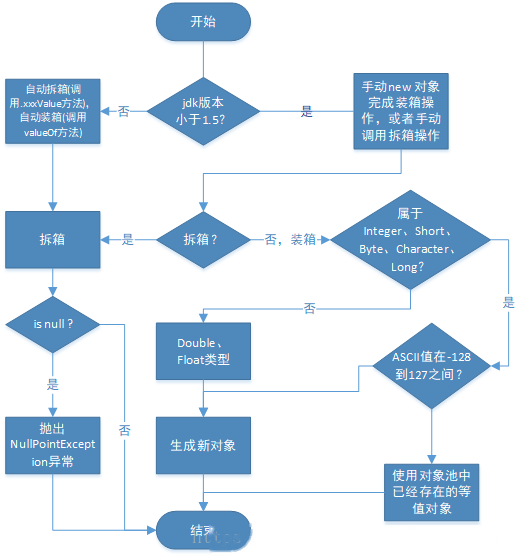

# 简介
简而言之装箱就是将基本数据类型转换为包装器类型；拆箱就是将包装器类型转换为基本数据类型。
在jdk1.5之前需要手动完成装箱和拆箱的操作。而在其之后，则能够自动完成拆箱和装箱
(Autoboxing and unboxing)。

## 类型对照
java中的基础数据类型和对应包装类型的对照表
基础类型 | 包装类型 | 基础类型暂用的内存大小（字节）
--|--|--------
int        | Integer        | 4
byte    | Byte           | 1
short   | Short           | 2
long    | Long           | 8
float   | Float          | 4
double  |Double            | 8
char    |Character      | 2
boolean | Boolean    | 未定

注意：
boolean类型没有给出精确的定义，但是根据《Java虚拟机规范》：
Java语言表达式所操作的boolean值，在编译之后都使用Java虚拟机中的int数据类型来代替，
而boolean数组将会被编码成Java虚拟机的byte数组，每个元素boolean元素占8位
所以**boolean类型单独使用是4个字节，在boolean数组中又是1个字节**。

# 装箱和拆箱流程
## 装箱和拆箱流程图



## 拆箱说明
手动调用.xxValue或者自动拆箱
```java
int a = new Integer(1);
//执行上面那句代码的时候，系统为我们执行了.xxValue方法：
int b= new Integer(1).intValue();
```
## 装箱说明
手动调用valueOf方法或者自动装箱
```java
Integer aa = 1;//自动调用valueof方法
Integer bb = Integer.valueOf(1);//手动装箱
```

# 拆箱和装箱后的相等性判断

## 拆箱相等性
拆箱后的数据存放在栈区，是基础数据类型。
用 == 判断相等性，并且比较的都是数值(即使所谓的类型不同，
最后都是变为数值的比较，对于char类型则转换为对应的ASCII码值比较)。

```java
int a = new Integer(66);
char b = (char)a;
System.out.println(b); //B
System.out.println(a == b); //true
System.out.println(a == 'B');//true
System.out.println(66L == 'B');//true
System.out.println(66.0f == 'B');//true
System.out.println(12541263521.0f == 12541263521L); //true
```
## 装箱后相等性
装箱后如果用 == 比较对象的内存地址，那么分为如下三种情况。

- Boolean类型
使用valueOf或者自动装箱操作的到的对象是对象池中的对象，手动new的对象则每次不一样。
```java
Boolean a_B = new Boolean(true);
Boolean b_B = new Boolean(true);
Boolean c_B = true;
boolean d_b = true; //和d_b做 == 运算时，会自动将对象拆箱做等值运算
Boolean e_B = Boolean.valueOf(true);
System.out.println(a_B == b_B); //false
System.out.println(a_B == c_B); //false
System.out.println(d_b == c_B); //true
System.out.println(a_B == d_b); //true
System.out.println(c_B == e_B); //true
```

- Double、Float类型
装箱后，每次都返回不同的对象实例，所以
```java
Float a = 1.0f;
Float b = 1.0f;
System.out.println(a == b); //false
```

- 非浮点数，字符
Integer派别：Integer、Short、Byte、Character、Long这几个类的valueOf方法的实现是类似的。
它们在运行时分为两种情况，一种是有对应的等值对象存放于对象池中，一种是没有。
对象池对应的范围：
类型 | 有等值对象的范围 | 无等值对象的范围
-- | --- | --- |
Short | [-128,127] | x >= 128 \|\| x < -128
Integer | [-128,127] | x >= 128 \|\| x < -128
Long | [-128,127] | x >= 128 \|\| x < -128
Character | x < 128 | x >= 128

 - 对象池中有对应等值对象
此时将会返回此对象池中的等值对象。

 - 没有对应等值对象
此时会返回一个新的对象，所以每次返回的对象都是不想等的。

boolean的valueOf实现：
```java
public static Boolean valueOf(boolean b) {
        return (b ? TRUE : FALSE);
    }
```
TRUE和FALSE在Boolean类中定义如下：
```java
public static final Boolean TRUE = new Boolean(true);

    /** 
     * The <code>Boolean</code> object corresponding to the primitive 
     * value <code>false</code>. 
     */
    public static final Boolean FALSE = new Boolean(false);
```

# 常见陷阱
- null拆箱
```java
Float f = null;
 //编译无错，运行时因调用f.intValue()是发现对象f是null，会报错
float ff = f;
System.out.println(ff);
```
-  拆箱/装箱规律
 - 包装类型和基础数据类型做算术运算/等值运算时，包装类型会自动拆箱
 - 调用equals方法是，会将基础数据类型做自动装箱
示例：
```java
Integer a = 100;
int b = 100;
Long ab = 200l;
System.out.println(ab == (a + b));  //true
System.out.println(ab.equals(a + b));  //false
```
此示例中出现了 == 为true而equals方法为false的少见情况。
因为做 == 运算时会自动将ab拆箱，然后做等值计算，所以值相等，结果是true。
而做equals运算时，会将a+b的结果做自动装箱，因为a+b=200,java默认是int类型，
200 > 127 ，所以自动装箱会建立一个新的Integer且值是200的对象。
而做equals是源码如下：
```java
@Override
 public boolean equals(Object o) {
     return (o instanceof Long) && (((Long) o).value == value);
 }
```
可见，因为类型Integer不等于Long，所以结果返回false。

# 内存和效率
- 基础数据类型效率更高
因为基础数据内存存放于栈区域，运行时直接通过寄存器寻值运算，效率高。
装箱类型存放于堆区域，只能间接寻值，效率较低。

- 拆箱操作
将堆中的值数据复制一个到栈上。

- 装箱操作
如果是从对象池中取出的数据，因为没有新建对象和分配内存/初始化的过程，所以效率较高
且内存几乎无额外消耗。对于其余的装箱，因为需要建立一个新的对象，所以效率低，且由于
每次都要建立新的对象所以十分消耗内存。

- 和强制转换对比
对于类型的强制转换和装箱/拆箱是不同的，强制转换时不产生新的对象的。
强制转换只有类型兼容性检查和安全性检查等性能消耗。
