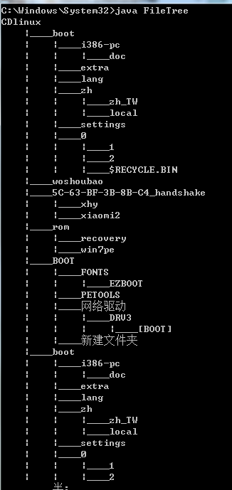

最新代码见:<http://blog.csdn.net/huitoukest/article/details/50516026>

```java
import java.io.File;

public class FileTree {
	public static void main(String args[]) {
		File h = new File("H:/");

		tree(h,0);
	}

	private static void tree(File f,int deep) {
		if(f.isDirectory()&&deep!=0)
		{String ss="";  
		 int k=deep;
		 while(k>0)
		{ ss=ss+"    |";
		 k--;
		 }
		  ss=ss+"____";		
		System.out.print(ss);
		 }
```

```java
		File[] childs = f.listFiles();// 列出当前目录中所有子目录
		for (int i = 0; i < childs.length; i++) {
			if (childs[i].isDirectory())
				{
System.out.println(childs[i].getName());

tree(childs[i],deep+1);
		        }
		}

	}
}
```

  
