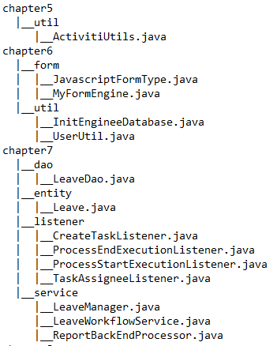

上一次的模拟地址:

    上一次的模拟式不成功的,当然一直也没有打算研究,地址如下<http://blog.csdn.net/huitoukest/article/details/21298021>,

    这一次偶然研究了下,结果如下;

```java
public class FileTree {
	public static void main(String args[]) {
		File h = new File("E:\\kftActiviti\\activiti-in-action-codes\\chapter8-mail\\src\\main\\java\\me\\kafeitu\\activiti");	
		getDeptTree(h, "", 0);
	}
	protected static void getDeptTree(File f,String prefix,int deep){
		if(!f.isDirectory())
		{
			System.out.println(f.getName()); 
		}else{
				File[] childs = f.listFiles();// 列出当前目录中所有子目录
				for (int i = 0; i < childs.length; i++) {

					String strLine ="";
					String ss="";		
					if(deep>0){
						if(childs.length-i>1)
						{
							ss=prefix+"  |";
						}else{
							ss=prefix+"   ";
						}
			            strLine=prefix+"  |__";
					}
					System.out.println(strLine+childs[i].getName()); 

					if (childs[i].isDirectory())
						{         
		                  getDeptTree(childs[i],ss, deep+1);
				        }
				}		
		}
	}
}
```

  
