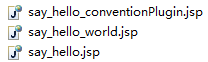
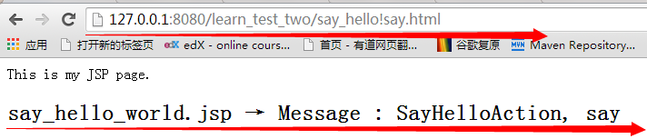

# struts2零配置:

1、struts2自2.1以后推荐使用Convention Plugin支持struts零配置支持(引入jar：struts2-convention-plugin-2.x.x.jar)  
①convention默认扫描所有实现com.opensymphony.xwork2.Action的类和指定包路径下以Action结尾的类名  
②struts.convention.package.locators指定默认的根packages，struts.convention.action.packages指定搜索的packages下的action，   
struts.convention.exclude.packages指定忽略的packages  
③默认视图路径：WEB-INF/content(可通过struts.convention.result.path修改)  
2、results和resultcodes  
①容器启动后，convention会自动加载所有action和jsp  
②可以指定不同的结果页面，action-resultcode.jsp  
③可以认为默认匹配顺序为actionName+resultcode+suffix>actionName+suffix

# 一：包名和url的转换->自动将action的名字，包括包名，转换成为命名空间+url地址；

通过这个url就可以访问action，然后根据action中返回的字符串和url组合形成jsp页面的地址；

示例：

1. com.example.actions.MainAction -> /main

2. com.example.actions.products.Display -> /products/display

3. com.example.struts.company.details.ShowCompanyDetailsAction -> /company/details/show-company-details

1. 从左往右，找到第一个包含struts或者action的报名中的文件夹名；com.example.actions.MainAction

2. 第二，截取从1中计算的之后的报名；MainAction

3. 去掉2中包含action或者struts的部分，剩下的转换成为小写即URL->/main

4.URL中，3中转换之前的URL中报名里面文件夹的名字是小写的，作为namespace，其余是action位置；/company/details/show-company-details

5./company/details/是namespace

Strut2的配置：

```xml
<?xml version="1.0" encoding="UTF-8" ?>
<!DOCTYPE struts PUBLIC
"-//Apache Software Foundation//DTD Struts Configuration 2.3//EN"
"http://struts.apache.org/dtds/struts-2.3.dtd">
<struts>

<constant name="struts.devMode" value="true"/>                                           <!-- 开发模式 -->
<constant name="struts.i18n.encoding" value="UTF-8"/>                                    <!-- Web运用编码 -->
<constant name="struts.convention.result.path" value="/" />                            <!-- 搜索视图资源的路径 -->
<constant name="struts.convention.action.name.separator" value="_" />                  <!-- Action类名分隔符 -->
<constant name="struts.convention.classes.reload" value="true" />                      <!-- convention类重加载 -->
<constant name="struts.convention.action.suffix" value="Action" />                     <!-- Action后缀名 -->
<constant name="struts.action.extension" value="action,do,html,htm,php,aspx" />        <!-- Action扩展名 -->
<constant name="struts.convention.package.locators" value="action,actions" />          <!-- 搜索Action资源的包路径 -->
<constant name="struts.convention.action.mapAllMatches" value="true"/>
<package name="default" namespace="/" extends="struts-default" />
<!--  
<constant name="struts.convention.action.suffix" value="Controller"/> 
<constant name="struts.convention.action.mapAllMatches" value="true"/> 
<constant name="struts.convention.default.parent.package" value="rest-default"/> 
<package name="default" namespace="/" extends="struts-default" />
-->
</struts>
```

Web.xml的配置：

```xml
<?xml version="1.0" encoding="UTF-8"?>
<web-app version="2.5" 
xmlns="http://java.sun.com/xml/ns/javaee" 
xmlns:xsi="http://www.w3.org/2001/XMLSchema-instance" 
xsi:schemaLocation="http://java.sun.com/xml/ns/javaee 
http://java.sun.com/xml/ns/javaee/web-app_2_5.xsd">

<filter>
<filter-name>struts2</filter-name>
<filter-class>org.apache.struts2.dispatcher.ng.filter.StrutsPrepareAndExecuteFilter</filter-class>
</filter>

<filter-mapping>
<filter-name>struts2</filter-name>
<url-pattern>/*</url-pattern>
</filter-mapping>
<!-- 需要注意的是这里不能够写成<url-pattern>/</url-pattern> ,可以写成<url-pattern>*.action</url-pattern> -->
<welcome-file-list>
<welcome-file>index.jsp</welcome-file>
</welcome-file-list>
</web-app>
```

示例Action：

```java
package com.fun.actions;

import org.apache.struts2.convention.annotation.Namespace;
import org.apache.struts2.convention.annotation.Result;

import com.opensymphony.xwork2.ActionSupport;
@Namespace("/")
//@Result(name="success",location="say_hello.jsp")
public class SayHelloAction extends ActionSupport {
    private static final long serialVersionUID = 1L;

    private String message;

    public String execute(){

        message = "Hello struts2 convention plugin!";
        return SUCCESS;
    }

    public String say(){

        message = "SayHelloAction, say";
        return "world";
    }

    public String sayHello(){

        message = "SayHelloAction, sayHello";
        return "conventionPlugin";
    }

    public String getMessage() {
        return message;
    }
}
```

jsp页面的配置：



访问规则，浏览器中url根据action的扩展名来访问相应action，然后action中根据返回的结果，返回不同的视图页面；



示例：访问webaap下的say_hello！say.html返回结果是say_hello_world.jsp这个视图页面；

分析：通过上面的规则say_hello转换成为相关的action(通过Action的扩展名来识别是否访问的是Action)，

即SayHello.class或者SayHelloAction.class这个Action；之后再访问action中的方法say()得到一个返回的字符串，“world”；

然后组合出jsp页面的地址：即action的URL(不包含扩展名和方法等)+”_”+返回的字符串；这里是say_hello_world.jsp

注意：默认返回的success字符串，这个对于的jsp页面就是URL的值+”.jsp”;比如上图的示例中返回的就是say_hello.jsp;

同时，默认的匹配规则还有如下这些：

URL |  Result |  File that could match |  Result Type  
---|---|---|---  
/hello |  success |  /WEB-INF/content/hello.jsp |  Dispatcher  
/hello |  success |  /WEB-INF/content/hello-success.htm |  Dispatcher  
/hello |  success |  /WEB-INF/content/hello.ftl |  FreeMarker  
/hello-world |  input |  /WEB-INF/content/hello-world-input.vm |  Velocity  
/test1/test2/hello |  error |  /WEB-INF/content/test/test2/hello-error.html |  Dispatcher  

二：Action链

Action链

如果在一个action结果中调用另外一个action ，他们俩将被链接到一起，如果在第一个action代码中未定义result，如下代码：

```java
package com.example.actions;

import com.opensymphony.xwork2.Action;
import com.opensymphony.xwork2.ActionSupport;

public class HelloAction extends ActionSupport {
    @Action("foo")
    public String foo() {
        return "bar";
    }

    @Action("foo-bar")
    public String bar() {
        return SUCCESS;
    }
}
```

“foo”action执行时候，由于找不到结果，convention尝试在同一个包下寻找action名为“foo-bar”的action。如果找到这样的action，convention将会调用并返回相关联的result。

一般用中划线或者下划线连接；foo_bar;

4、XWork packages  
①为了避免冲突，可将action放在一个自定义XWORK的package下  
②package命名由action所在的Java包,action对应的URL中namespace部分以及action的parent XWork package三个部分组成，即：

<java-package>#<namespace>#<parent-package>

③parent XWork package 值在属性 struts.convention.default.parent.package 中指定（默认为convention-default）

<constant name="struts.convention.default.parent.package" value="convention-default"/>

5、Annotation reference  
Convention使用很多注解来重写默认插件的action到url的映射和result路径。同时，也可以通过修改parent XWork package  
通过使用@Action注解，Convention plugin可以改变action映射的url，同时也可以使一个action对应多个url地址，例如：

```java
package com.example.actions;

import com.opensymphony.xwork2.ActionSupport;
import org.apache.struts2.convention.annotation.Action;

public class HelloWorld extends ActionSupport {
    @Action("/different/url")
    public String execute() {
        return SUCCESS;
    }
}
```

这时，action映射的url地址将是/different/url，如果没有定义@Result，则该namespace下的action路径将被当作result path，即WEB-   
INF/content/different/url.jsp  
通过@Actions注解，一个方法可以对应多个url路径，如：

```java
package com.example.actions;

import com.opensymphony.xwork2.ActionSupport;
import org.apache.struts2.convention.annotation.Action;
import org.apache.struts2.convention.annotation.Actions;

public class HelloWorld extends ActionSupport {
    @Actions({
        @Action("/different/url"),
        @Action("/another/url")
    })
    public String execute() {
        return SUCCESS;
    }
}
```

另外一种使用@Action和@Actions的例子是在一个Action类中定义多个方法，使用不同的注解，对应不同的url，如：

```java
package com.example.actions;

import com.opensymphony.xwork2.ActionSupport;
import org.apache.struts2.convention.annotation.Action;
import org.apache.struts2.convention.annotation.Actions;

public class HelloWorld extends ActionSupport {
    @Action("/different/url")
    public String execute() {
        return SUCCESS;
    }

    @Action("url")
    public String doSomething() {
        return SUCCESS;
    }
}
```

第二个方法中的相对路径注解不推荐使用，它的路径将取决与package对应的namespace而不是由Action注解决定  
Interceptor和interceptor stacks同样可以使用注解，下面的例子使用了validation interceptor和defaultStack interceptor stack：

```java
package com.example.actions;

import com.opensymphony.xwork2.ActionSupport;
import org.apache.struts2.convention.annotation.Action;
import org.apache.struts2.convention.annotation.Actions;

public class HelloWorld extends ActionSupport {
    @Action(interceptorRefs={@InterceptorRef("validation"), @InterceptorRef("defaultStack")})
    public String execute() {
        return SUCCESS;
    }
    @Action("url")
    public String doSomething() {
        return SUCCESS;
    }
}
```

InterceptorRefs可用于方法或Action类，若用于类上，则对所有方法有效

```java
package com.example.actions;

import com.opensymphony.xwork2.ActionSupport;
import org.apache.struts2.convention.annotation.Action;
import org.apache.struts2.convention.annotation.Actions;

@InterceptorRefs({
    @InterceptorRef("interceptor-1"),
    @InterceptorRef("defaultStack")
})
public class HelloWorld extends ActionSupport {
    @Action(value="action1", interceptorRefs=@InterceptorRef("validation"))
    public String execute() {
        return SUCCESS;
    }

    @Action(value="action2")
    public String doSomething() {
        return SUCCESS;
    }
}
```

注意：如果遇到"Unable to find interceptor class referenced by ref-name XYZ",则说明在convention扫描Action类时，没有Interceptor指定的拦截器。

处理方式为：

1使用@ParentPackage注解(或者指定struts.convention.default.parent.package)指定定义了该Interceptor的package;

2创建一个package并继承定义了该Interceptor的package，同时使用@ParentPackage(或者 struts.convention.default.parent.package)指定该package

同时也可以指定params参数，使用 {"key0", "value0, "key1", "value1" ... "keyN", "valueN"}形式

```java
package com.example.actions;

import com.opensymphony.xwork2.ActionSupport;
import org.apache.struts2.convention.annotation.Action;
import org.apache.struts2.convention.annotation.Actions;

public class HelloWorld extends ActionSupport {
    @Action(interceptorRefs=@InterceptorRef(value="validation",params={"programmatic", "false", "declarative", "true}))
        public String execute() {
            return SUCCESS;
        }

        @Action("url")
        public String doSomething() {
            return SUCCESS;
        }
    }
```

若未指定interceptors，则使用default stack  
如果将@Action，@Actions用于Action类，若该类中定义了execute，则该方法将用于action映射，否则应用的方法取决于请求  
对于结果注解@Results可分为全局和局部，全局@Results定义在Action类，对所有方法有效，局部@Results定义在方法上，只对该方法有效

```java
package com.example.actions;

import com.opensymphony.xwork2.ActionSupport;
import org.apache.struts2.convention.annotation.Action;
import org.apache.struts2.convention.annotation.Actions;
import org.apache.struts2.convention.annotation.Result;
import org.apache.struts2.convention.annotation.Results;

@Results({
    @Result(name="failure", location="fail.jsp")
})
public class HelloWorld extends ActionSupport {
    @Action(value="/different/url",
    results={@Result(name="success", location="http://struts.apache.org", type="redirect")}
    )
    public String execute() {
        return SUCCESS;
    }

    @Action("/another/url")

    public String doSomething() {
        return SUCCESS;
    }
}
```

在@Results注解中可以使用@params, {"key0", "value0, "key1", "value1" ... "keyN", "valueN"}

```java
package com.example.actions;

import com.opensymphony.xwork2.ActionSupport;
import org.apache.struts2.convention.annotation.Action;
import org.apache.struts2.convention.annotation.Actions;
import org.apache.struts2.convention.annotation.Result;
import org.apache.struts2.convention.annotation.Results;

public class HelloWorld extends ActionSupport {
    @Action(value="/different/url",
    results={@Result(name="success", type="httpheader", params={"status", "500", "errorMessage", "Internal Error"})}
    )
    public String execute() {
        return SUCCESS;
    }

    @Action("/another/url")
    public String doSomething() {
        return SUCCESS;
    }
}
```

从2.1.7版本后,@Results可以被子类继承  
对于@Namespace注解可应用于Action类和packages中，在类上使用时为非完全限定

```java
package com.example.actions;

import com.opensymphony.xwork2.ActionSupport;
import org.apache.struts2.convention.annotation.Action;
import org.apache.struts2.convention.annotation.Namespace;

@Namespace("/custom")
public class HelloWorld extends ActionSupport {
    @Action("/different/url")
    public String execute() {
        return SUCCESS;
    }

    @Action("url")
    public String doSomething() {
        return SUCCESS;
    }
}
```

该Action类对应两个url： /different/url和/custom/url

@org.apache.struts2.convention.annotation.Namespace("/custom")

package com.example.actions;

应用于package时，子包不继承该namespace  
对于@ResultPath允许改变默认的结果存放地址，该注解可用于Action类和package

```java
package com.example.actions;

import com.opensymphony.xwork2.ActionSupport;
import org.apache.struts2.convention.annotation.Action;
import org.apache.struts2.convention.annotation.ResultPath;

@ResultPath("/WEB-INF/jsps")
public class HelloWorld extends ActionSupport {
    public String execute() {
        return SUCCESS;
    }
}
```

经过注解，该Action类对应的result地址为/WEB-INF/jsps,而不是默认的/WEB-INF/content  
对于@ParentPackage允许应用为Action类或java package定义不同的parent Struts package，也可以通过struts.convention.default.parent.package指定

```java
package com.example.actions;

import com.opensymphony.xwork2.ActionSupport;
import org.apache.struts2.convention.annotation.Action;
import org.apache.struts2.convention.annotation.ParentPackage;

@ParentPackage("customXWorkPackage")
public class HelloWorld extends ActionSupport {
    public String execute() {
        return SUCCESS;
    }
}
```

对于@ExceptionMappings可以指定Action类或方法的异常映射

```java
@ExceptionMappings({
    @ExceptionMapping(exception = "java.lang.NullPointerException", result = "success", params = {"param1", "val1"})
})
public class ExceptionsActionLevelAction {

    public String execute() throws Exception {
        return null;
    }
}
public class ExceptionsMethodLevelAction {
    @Action(value = "exception1", exceptionMappings = {
        @ExceptionMapping(exception = "java.lang.NullPointerException", result = "success", params = {"param1", "val1"})
    })
    public String run1() throws Exception {
        return null;
    }
}
```

对于jar包，Convention plugin默认不会扫描其中的Action，若希望扫描，则需要配置struts.convention.action.includeJars

<constant name="struts.convention.action.includeJars" value=".*?/myjar1.*?jar(!/)?,.*?/myjar2*?jar(!/)?">

注意，此处正则表达式匹配的是jar的路径而不是文件名，该路径下应包含jar并以"!/"结尾  
Convention plugin可以自动重载配置的修改，扫描Action的改动，若要启用该功能，需要配置

<constant name="struts.devMode" value="true"/>

<constant name="struts.convention.classes.reload" value="true" />

生产环境下，强烈建议不使用该功能  
6、Tips  
①确保action的namespace与locators中的一个匹配，在locators后面的包路径后面，将作为action的namespace，同时将用于定位results。例如对于位   
于"my.example.actions.orders"路径下的ViewAction将对应映射'/orders/view.action',并且结果必将位于/WEB-INF/content/orders,类似/WEB-   
INF/content/orders/view-success.jsp  
②使用Configuration Browser查看action映射  
③打开跟踪或调试，如log4j中增加：log4j.logger.org.apache.struts2.convention=DEBUG  
常见问题  
①'There is no Action mapped for namespace /orders and action name view.'这意味着URL /orders/view.action为对应任何一个action类，检查namespace和该   
名称的action  
②'No result defined for action my.example.actions.orders.ViewAction and result success'这意味者action已成功映射到Url，但是Convention插件没有找到   
success result，检查视图文件是否存在，类似/WEB-INF/content/orders/view-success.jsp  
③'java.lang.Exception: Could not load org/apache/velocity/runtime/resource/loader/ClasspathResourceLoader.class'这发生在   
struts.convention.action.includeJars匹配外部jar包时  
④当使用自定义interceptor stack时，发生'Unable to find interceptor class referenced by ref-name XYZ'这意味着convention插件在解析actions时，没有继   
承该Interceptor定义的那个package，解决方式有两种1)使用 @ParentPackage(或struts.convention.default.parent.package)指定定义了该拦截器的package;2)自   
定义package并继承定义了该Interceptor的package，并使用@ParentPackage(或struts.convention.default.parent.package)指定  
7、重写convention实现rent.package)指定

<bean type="org.apache.struts2.convention.ActionNameBuilder" name="MyActionNameBuilder" class="example.SultansOfSwingNameBuilder"/>

<constant name="struts.convention.actionNameBuilder" value="MyActionNameBuilder"/>

8、convention插件配置：

Name |  Default Value |  Description  
---|---|---  
struts.convention.action.alwaysMapExecute |  true |  Set to false, to prevent Convention from creating a default mapping to "execute" when there are other methods annotated as actions in the class  
struts.convention.action.includeJars |    |  Comma separated list of regular expressions of jar URLs to be scanned. eg. ".*myJar-0\\.2.*,.*thirdparty-0\\.1.*"  
struts.convention.action.packages |    |  An optional list of action packages that this should create configuration for (they don't need to match a locator pattern)  
struts.convention.result.path |  /WEB-INF/content/ |  Directory where templates are located  
struts.convention.result.flatLayout |  true |  If set to false, the result can be put in its own directory: resultsRoot/namespace/actionName/result.extension  
struts.convention.action.suffix |  Action |  Suffix used to find actions based on class names  
struts.convention.action.disableScanning |  false |  Scan packages for actions  
struts.convention.action.mapAllMatches |  false |  Create action mappings, even if no @Action is found  
struts.convention.action.checkImplementsAction |  true |  Check if an action implements com.opensymphony.xwork2.Action to create an action mapping  
struts.convention.default.parent.package |  convention-default |  Default parent package for action mappins  
struts.convention.action.name.lowercase |  true |  Convert action name to lowercase  
struts.convention.action.name.separator |  - |  Separator used to build the action name, MyAction -> my-action. This character is also used as the separator between the action name and the result in templates, like action-result.jsp  
struts.convention.package.locators |  action,actions,struts,struts2 |  Packages whose name end with one of these strings will be scanned for actions  
struts.convention.package.locators.disable |  false |  Disable the scanning of packages based on package locators  
struts.convention.exclude.packages |  org.apache.struts.*,  
org.apache.struts2.*,  
org.springframework.web.struts.*,  
org.springframework.web.struts2.*,  
org.hibernate.* |  Packages excluded from the action scanning  
struts.convention.package.locators.basePackage |    |  If set, only packages that start with its value will be scanned for actions  
struts.convention.relative.result.types |  dispatcher,velocity,freemarker |  The list of result types that can have locations that are relative and the result location (which is the resultPath plus the namespace) prepended to them  
struts.convention.redirect.to.slash |  true |  A boolean parameter that controls whether or not this will handle unknown actions in the same manner as Apache, Tomcat and other web servers. This handling will send back a redirect for URLs such as /foo to /foo/ if there doesn't exist an action that responds to /foo  
struts.convention.classLoader.excludeParent |  true |  Exclude URLs found by the parent class loader from the list of URLs scanned to find actions (needs to be set to false for JBoss 5)  
struts.convention.action.eagerLoading |  false |  If set, found action classes will be instantiated by the ObjectFactory to accelerate future use, setting it up can clash with Spring managed beans  

参见:[http://struts.apache.org/release/2.1.x/docs/convention-plugin.html](http://struts.apache.org/release/2.1.x/docs/convention-plugin.html)

本地Result需要注意的地方:

2 本地的（local）。

本地results只能在action方法上进行声明。

Java代码

```java
package com.example.actions;

import com.opensymphony.xwork2.ActionSupport;
import org.apache.struts2.convention.annotation.Action;
import org.apache.struts2.convention.annotation.Actions;
import org.apache.convention.annotation.Result;
import org.apache.convention.annotation.Results;

public class HelloWorld extends ActionSupport {
    @Action(value="/other/bar",results={@Result(name = "error", location = "www.baidu.com",type="redirect")})
    public String method1() {
        return “error”;
    }
}
```

当我们调用 /hello -world !method1.action 时，返回 /WEB-INF/content/hello-error.jsp

当我们调用 /other/bar!method1.action 时，返回 [www.baidu.com](http://www.baidu.com)

注意:如果同时配置了全局Result和局部Result,那么一般以全局Result的结果为准;
