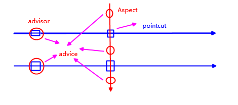

# 在AOP中有几个概念：

— 方/切 面（Aspect）：一个关注点的模块化，这个关注点实现可能另外横切多个对象。事务管理是J2EE应用中一个很好的横切关注点例子。方面用Spring的Advisor或拦截器实现。   
— 连接点/织入点（Joinpoint）：程序执行过程中明确的点，如方法的调用或特定的异常被抛出。   
— 通知（Advice）：在特定的连接点，AOP框架执行的动作。各种类型的通知包括“around”、“before”和“throws”通知。   
— 切入点（Pointcut）：指定一个通知将被引发的一系列连接点的集合。AOP框架必须允许开发者指定切入点，例如，使用正则表达式。   

所以“<aop:aspect>”实际上是定义横切逻辑，就是在连接点上做什么，“<aop:advisor>”则定义了在哪些连接点应用什么<aop:aspect>。Spring这样做的好处就是可以让多个横切逻辑（即<aop:aspect>定义的）多次使用，提供可重用性。

1、Adivisor是一种特殊的Aspect，Advisor代表spring中的Aspect   
2、区别：advisor只持有一个Pointcut和一个advice，而aspect可以多个pointcut和多个advice

tingfeng的理解:

示意图如上:

我们平常的程序执行可以看成是横向的箭头,具有线性执行的特性;

蓝色的小方框可以堪称是一个个线性执行中打断进程的切入点PointCut;

有个Pointcut,那么就可以在切入点上面执行相关的逻辑,罗技分为两种,一种是adivisor,还有一种是Aspect;

其中Advisor如同上图左边的小红圈,只能够有一个advice,是一个点逻辑;

右边的向下的箭头可以看作是Aspect,其可以拥有执行多个逻辑,是一个面逻辑;
