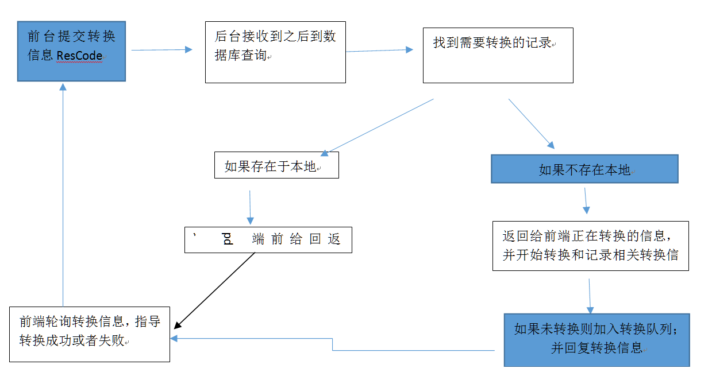

# 1.从view访问到controller的思路



# 2.关于office转换为pdf

实现手段可以参见openoffice转pdf或者别的软件，网上有具体的转换手段，我这里不多说；

大概代码如下，这里的OfficeToPDFInfo是一个包含输入输入路径等的一个Bean：

    /**
    	 * 将Office文档转换为PDF. 运行该函数需要用到OpenOffice, OpenOffice下载地址为
    	 * http://www.openoffice.org/
    	 * @param sourceFile
    	 *            源文件, 绝对路径. 可以是Office2003-2007全部格式的文档, Office2010的没测试. 包括.doc,
    	 *            .docx, .xls, .xlsx, .ppt, .pptx等. 示例: F:\\office\\source.doc
    	 * @param destFile
    	 *            目标文件. 绝对路径. 示例: F:\\pdf\\dest.pdf
    	 * @return 	    操作成功与否的提示信息. 如果返回 -1, 表示找不到源文件, 或url.properties配置错误; 如果返回 0,
    	 *            则表示操作成功; 返回1, 则表示转换失败
    	 */
    	private static int office2PDF(OfficeToPDFInfo officeToPDFInfo) {
    		String sourceFile=officeToPDFInfo.sourceUrl;
    		String destFile=officeToPDFInfo.destUrl;
    		String OpenOffice_HOME=officeToPDFInfo.openOfficeHOME;
    		try {
    			File inputFile = new File(sourceFile);
    			if (!inputFile.exists()) {
    				return -1;// 找不到源文件, 则返回-1
    			}

    			// 如果目标路径不存在, 则新建该路径
    			File outputFile = new File(destFile);
    			if (!outputFile.getParentFile().exists()) {
    				outputFile.getParentFile().mkdirs();
    			}

    			//= "D:\\Program Files\\OpenOffice.org 3";//这里是OpenOffice的安装目录, 在我的项目中,为了便于拓展接口,没有直接写成这个样子,但是这样是绝对没问题的
    			// 如果从文件中读取的URL地址最后一个字符不是 '\'，则添加'\'
    			if (OpenOffice_HOME.charAt(OpenOffice_HOME.length() - 1) != '\\') {
    				OpenOffice_HOME += "\\";
    			}
    			// 启动OpenOffice的服务
    			String command = OpenOffice_HOME
    					+ "program\\soffice.exe -headless -accept=\"socket,host=127.0.0.1,port=8100;urp;StarOffice.ServiceManager\" -nofirststartwizard";
    			Process pro = Runtime.getRuntime().exec(command);

```java
			// connect to an OpenOffice.org instance running on port 8100
			OpenOfficeConnection connection = new SocketOpenOfficeConnection(
					"127.0.0.1", 8100);
			connection.connect();
			// convert
			DocumentConverter converter = new OpenOfficeDocumentConverter(connection);
			//DocumentConverter converter = new StreamOpenOfficeDocumentConverter(connection); 

			converter.convert(inputFile, outputFile);
			// close the connection
			connection.disconnect();
			// 关闭OpenOffice服务的进程
			pro.destroy();
			return 0;
		} catch (FileNotFoundException e) {
			e.printStackTrace();
			return -1;
		} catch (ConnectException e) {
			e.printStackTrace();
		} catch (IOException e) {
			e.printStackTrace();
		}

		return 1;
	}
```

    public class OfficeToPDFInfo {

    	/**
    	 * 转换的来源路径
    	 */
    	public String sourceUrl;
    	/**
    	 * 转换后的本地路径
    	 */
    	public String destUrl;
    	/**
    	 * 这里是OpenOffice的安装目录
    	 */
    	public String openOfficeHOME;
    	/**
    	 * 单个任务执行的超时时间;
    	 */

```java
	public Integer task_execution_timeout;

}
```

# 3.转换队列

为了更加合理的利用资源，一个转换队列是必不可少的，**这里用一个线程list作为线程队列，用另外一个线程来管理这个队列；**

**用一个map来记录相关的状态；**

转换的自定义Properties，其中转换的并行度最好和其服务器的cpu虚拟核心数量相同：

    public class OfficeToPDFProperty {
    	/**
    	 * 转换后的本地保存文件夹
    	 */
    	public String destFolder;
    	/**
    	 * 这里是OpenOffice的安装目录
    	 */
    	public String openOfficeHome="";
    	/**
    	 * 单个任务执行的超时时间;
    	 */
    	public Integer task_execution_timeout=60000;
    	/**
    	 * 同时转换的最大并发数量；
    	 */
    	public int maxThreadCount=0;
    	/**
    	 * 转换完成的状态保持时间
    	 */
    	public int convertionStatusKeepTime=0;
    	/**
    	 * 转换（包括失败），最多convertionTryCount次；
    	 */
    	public int convertionTryCount=0;
    	/**
    	 * 当前pdf转换状态的最大保存数量，超过此数量后将会抛弃时间最久的状态；
    	 */
    	public int convertionStatusMaxCount=1000;
    	/**
    	 * 被转换的office文档的文件最大大小，超过此大小后，将不会转换；
    	 * 默认100M,单位字节;
    	 */
    	public int fileMaxSize=104857600;
    }

转换的线程管理：

    public class OfficeToPDFService {
    	/**
    	 * 将运行前的线程加入线程池，运行开始后移出线程池；线程池中保存的是当前等待转换的线程队列
    	 */
    	private static List<Thread> office2PDFThreadPool=new LinkedList<Thread>();
    	/**
    	 * 当前正在运行的转换线程的数量
    	 */
    	private static int convertionCount=0;

    	private static Thread initConvertionThread=null;
    	/**
    	 * 初始化线程池的运行,每2秒钟，检查一次转换的线程池
    	 */
    	private static synchronized void initConvertionThreadPool(){
    		OfficeToPDFProperty officeToPDFProperty=null;
    		try {
    			officeToPDFProperty = OfficeToPDFPropertyService.getOfficeToPDFProperty();
    		} catch (InstantiationException | IllegalAccessException | IOException e1) {
    			e1.printStackTrace();
    		}
    		final int maxCount=officeToPDFProperty.maxThreadCount;
    		if(initConvertionThread==null){
    			initConvertionThread=new Thread(new Runnable() {	
    				@Override
    				public void run() {
    					while(true){
    							int i=0;
    							if(getConvertionCount()<maxCount&&getThreadWaitCount()>i){
    								Thread converThread=getOffice2PDFThreadByThreadPool(i);
    								if(!converThread.isAlive()){
    									converThread.start();									
    									continue;
    								}
    								i++;
    							}
    						try {
    							Thread.sleep(2000);
    						} catch (InterruptedException e) {
    							e.printStackTrace();
    						}
    					}
    				}
    			});
    			initConvertionThread.start();
    		}
    	}

    	/**
    	 * 将状态为非结束状态的转换的文件加入转换池中
    	 * 只转换OfficeConverionStatus.NoStart的文件
    	 * @param path
    	 * @param desPath
    	 */

```java
	public static void addOfficeFileToConvertionThreadPool(final String path,final String desPath) {
		initConvertionThreadPool();
		final String originFileName=FileUtils.getFileNameByPath(path);
		OfficeConverionStatus status=MyConstants.getConvertionType(originFileName);
		if(status!=OfficeConverionStatus.NoStart)
			return;
		MyConstants.putConvertionStatus(originFileName, OfficeConverionStatus.Ready);
		final Thread thread=new Thread(new Runnable() {			
			@Override
			public void run() {
				decrementConvertionCount();
				try {		
					incrementConvertionCount();
					MyConstants.putConvertionStatus(originFileName, OfficeConverionStatus.Converting);	
					OfficeToPDFProperty officeToPDFProperty=OfficeToPDFPropertyService.getOfficeToPDFProperty();
					OfficeToPDFInfo info=new OfficeToPDFInfo();
					info.destUrl=desPath;
					info.sourceUrl=path;
					info.openOfficeHOME=officeToPDFProperty.openOfficeHome;
					info.task_execution_timeout=officeToPDFProperty.task_execution_timeout;
					int result=1;
					int convertionTryCount=officeToPDFProperty.convertionTryCount;					
						while(result!=0&&convertionTryCount-->0){
							try {
								result=office2PDF(info);
							} catch (Exception e) {
								e.printStackTrace();
								result=1;
							}							
						}//end while
					if(result==-1){
						MyConstants.putConvertionStatus(originFileName, OfficeConverionStatus.NoFile);						
					}else if(result==1)
					{
						MyConstants.putConvertionStatus(originFileName, OfficeConverionStatus.Faild);
					}else if(result==0){
						MyConstants.putConvertionStatus(originFileName, OfficeConverionStatus.Success);
					}				
				} catch (InstantiationException e) {
					e.printStackTrace();
					MyConstants.putConvertionStatus(originFileName, OfficeConverionStatus.Faild);
				} catch (IllegalAccessException e) {
					e.printStackTrace();
					MyConstants.putConvertionStatus(originFileName, OfficeConverionStatus.Faild);
				} catch (IOException e) {
					e.printStackTrace();
					MyConstants.putConvertionStatus(originFileName,OfficeConverionStatus.Faild);
				}finally{					
					removeThreadFromOffice2PDFThreadPool(Thread.currentThread());
				}							
			}
		});
		addThreadTOOffice2PDFThreadPool(thread);
	}
```

    	/**
    	 * 得到当前等待的线程的数量
    	 * @return
    	 */

```java
	public static synchronized int getThreadWaitCount(){
		return office2PDFThreadPool.size();
	}
	public static synchronized Thread getOffice2PDFThreadByThreadPool(int index) {
		return office2PDFThreadPool.get(index);
	}

	public static synchronized void addThreadTOOffice2PDFThreadPool(Thread office2pdfThread) {
			office2PDFThreadPool.add(office2pdfThread);		
	}

	private static synchronized void removeThreadFromOffice2PDFThreadPool(Thread office2pdfThread) {
		office2PDFThreadPool.remove(office2pdfThread);		
	}

	private synchronized static  int getConvertionCount() {
			return convertionCount;
	}

	private  synchronized static void incrementConvertionCount() {
			convertionCount = convertionCount+1;
	}

	private synchronized static void decrementConvertionCount(){
			convertionCount = convertionCount-1;
	}
```

# 4.转换状态的保存：

    public class MyConstants {
    	private static String[] officeFile
    		=new String[]{"doc","docx","ppt","pptx","xls","xlsx"};
    	public static String[] getOfficeFileExtentionNames(){
    		return officeFile;
    	}
    	/**
    	 * 判断是否是office文件
    	 * @param path
    	 * @return
    	 */
    	public static boolean isOfficeFile(String path){
    		if(StringJudgeUtils.isEmpty(path))
    			return false;
    		for(int i=0;i<officeFile.length;i++){
    			String nameString=FileUtils.getFileExtension(path);
    			if(nameString.equalsIgnoreCase(officeFile[i])){
    				return true;
    			}
    		}
    		return false;
    	}
    	/**
    	*用来保存转换的状态
    	**/
    	private static Map<String, OfficeConverionStatus> convertionTypes=new HashMap<String, OfficeConverionStatus>();
    	/**
    	 *
    	 * @param originFileName 转换之前的文件名称
    	 * @return 当前转换的状态
    	 */
    	public static synchronized OfficeConverionStatus getConvertionType(String originFileName){
    		OfficeConverionStatus converionStatus=convertionTypes.get(originFileName);
    		if(converionStatus==null)
    			converionStatus=OfficeConverionStatus.NoStart;
    		return converionStatus;
    	}
    	/**
    	 * 加入新的转换状态的时候，会自动移出旧的状态；
    	 * @param originFileName
    	 * @param converionStatus 当前转换的状态
    	 */
    	public static synchronized void putConvertionStatus(String originFileName,OfficeConverionStatus converionStatus){
    		convertionTypes.put(originFileName,converionStatus);
    		putConvertionTime(originFileName, System.currentTimeMillis());
    	}
    	/**
    	 * 将指定文件名的状态移出
    	 * @param originFileName
    	 */
    	private static synchronized void removeConvertionStatus(String originFileName){
    		convertionTypes.remove(originFileName);
    	}

    	/**
    	 * 保存线程转换的结束时间和线程转换的状态相对应，转换结束后24小时内没有访问结果的将会被清除；
    	 */
    	private static Map<String, Long> convertionTimeMap=new HashMap<String, Long>();
    	/**
    	 *
    	 * @param originFileName 转换之前的文件名称
    	 * @return 当前转换的状态
    	 */
    	public static synchronized Long getConvertionTime(String originFileName){
    		Long converionTime=convertionTimeMap.get(originFileName);
    		if(converionTime==null)
    			converionTime=new Date(2000,1,1).getTime();
    		return converionTime;
    	}

    	public static synchronized int getConvertionTypesSize(){
    		return convertionTypes.size();
    	}
    	/**
    	 * 加入新的转换状态的时候，会自动移出旧的状态；
    	 * 数量超过convertionStatusMaxCount会移出更多老旧状态
    	 * @param originFileName
    	 * @param cTime
    	 */

```java
	private static synchronized void putConvertionTime(String originFileName,Long cTime){
		convertionTimeMap.put(originFileName,cTime);
		Set<String> keySet=convertionTimeMap.keySet();
		OfficeToPDFProperty officeToPDFProperty;
		try {
			officeToPDFProperty = OfficeToPDFPropertyService.getOfficeToPDFProperty();
			int keepTimeLong=officeToPDFProperty.convertionStatusKeepTime;
			int convertionStatusMaxCount=officeToPDFProperty.convertionStatusMaxCount;
			List<String> removeKeyStrings=new ArrayList<String>();
			do{
				for(String key:keySet){
					Long timeLong=convertionTimeMap.get(key);					
					if(System.currentTimeMillis()-timeLong>keepTimeLong){
						removeKeyStrings.add(key);
					}
				}	
				for(String key:removeKeyStrings){
					convertionTimeMap.remove(key);
					removeConvertionStatus(key);
				}
				keepTimeLong=(int)(keepTimeLong*0.95);
			}while(getConvertionTypesSize()>convertionStatusMaxCount);

		} catch (InstantiationException | IllegalAccessException | IOException e) {
			e.printStackTrace();
		}	
	}
	/*public static synchronized void removeConvertionTime(String originFileName){
		convertionTime.remove(originFileName);
	}*/

}
```

# 5.小结

注意线程之间的加锁互斥，没有贴出的代码无关核心思想，因为时间原因，以后以机会可以做成模块，打包为jar形式，不过openoffice转pdf的时候，

遇到部分ppt文档可能会出现转换失败的情况；
