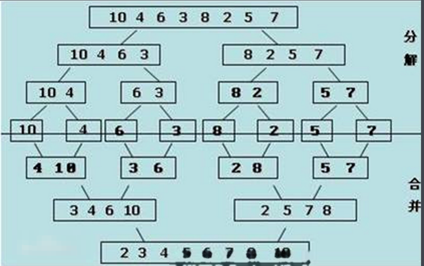

# 1.简介

几天不看算法就都忘了，正好学习scala，来复习下算法顺便。

归并排序，思想是分而治之，然后合并得出结果。

分为两个阶段：

1.拆分（这里以拆分为两个部分为示例）

将一个数据集合分为A，B两个部分，分别对A，B排序，

而对A，B排序的方法，同样是将之分为两个部分然后排序。如此会得到一个结果就是最终，A和B这两个部分是有序的；

比如10,4,6,3,8,2,5,7变为3,4,6,10和2,5,7,8两个部分。

2.合并

在得到A，B两个有序的数据集后，因为A和B都是有序的，可以通过将A集合中元素用折半查找然后插入B集合的复制数据集的方式来得到一个合并后的集合。

# 2.示意图

·

# 3.代码

```scala
object MergeSort {

def msort[T](less:(T,T)=>Boolean)(xs:List[T]):List[T]={
//xs.foreach { x => print(x+" "); }
//println("____");
def merge(xs:List[T],ys:List[T]):List[T]={
/* xs.foreach { x => print(x+" ");}
print(" and ")
ys.foreach { x => print(x+" "); }
println();*/
(xs,ys) match{
case (Nil,_)=>ys;
case (_,Nil)=>xs;
case (x::xs1,y::ys1) => {//这里的merge方法是合并作用，但是合并之前通过模式匹配的::符号对数据进行的拆分
if(less(x,y)) x::merge(xs1,ys)
else y::merge(xs,ys1)
};
}
}
val n=xs.length/2;
if(n==0) xs;
else {
val (ys,zs) =xs.splitAt(n);
merge(msort(less)(ys),msort(less)(zs));
}
}   
def main(args: Array[String]): Unit = {
val k=msort((a:Int,b:Int)=>a<b)(List(10,4,6,3,8,2,5,7));
k.foreach { x => print(x+" "); }
}
}
```
